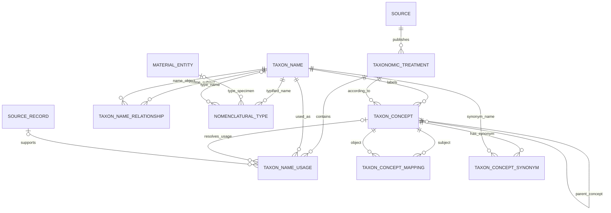
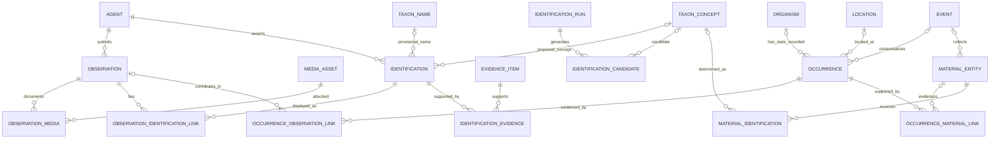
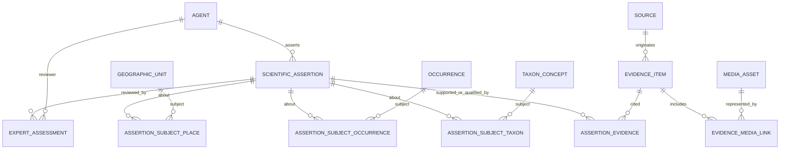
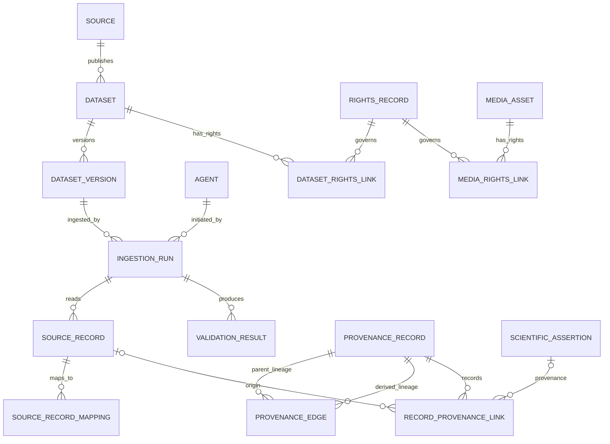
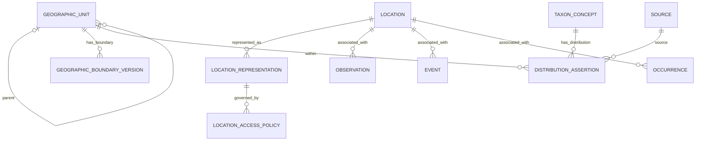

# Task 05C — Logical Database Model and Scientific Data Relationships

- **Status:** Proposed logical model — review required
- **Version:** 0.1
- **Date:** 2026-11-11
- **Scope:** Botanica Indica domain data; shared STF platform services are referenced only at their integration boundaries
- **Related documents:** Task 05 data architecture; Task 05B scientific data dictionary; ADR-002 through ADR-010; proposed ADR-011
- **Decision status:** No physical database schema, SQL migration, database engine deployment or API implementation is authorized by this document.

---

## 1. Purpose and modelling rules

This document translates the conceptual data architecture and data dictionary into a reviewable logical relational model. It defines entity boundaries, relationships, cardinalities, key strategy, integrity rules, lifecycle behavior, access boundaries and interoperability mappings.

It is deliberately a **logical model**, not an implementation schema. Physical types, exact table names, indexes, partitioning, extension versions, SQL functions, triggers and migrations are deferred until the logical model is reviewed against representative source records and expert workflows.

### 1.1 Non-negotiable modelling principles

1. A nomenclatural name is not the same thing as a taxonomic concept.
2. A taxonomic concept must retain its according-to treatment/source context.
3. A source's taxon-name usage and status must be preserved as source-scoped assertions.
4. A user-submitted Observation is not automatically a Darwin Core Occurrence.
5. An Organism, Occurrence and MaterialEntity are distinct concepts.
6. A specimen is physical material; a photograph is a digital MediaAsset; neither should be confused with the occurrence itself.
7. An Identification is a revisable determination with an agent, method, time, target and evidence.
8. An AI candidate is not an accepted Identification or expert determination.
9. A scientific assertion is attributable, scoped and supported/qualified by evidence.
10. Original coordinates and generalized/public coordinates must remain distinct.
11. Source records, dataset versions, ingestion runs and transformations must be traceable.
12. Rights are evaluated per asset, dataset, purpose and operation; unknown is not permission.
13. Stable internal identifiers must not depend on mutable names, taxonomic status, coordinates or source row positions.
14. External standards are exchange mappings, not a mandate to copy every external schema as the internal database.

## 2. Standards verification and important corrections

### 2.1 Taxon Concept Standard (TCS)

The current TCS terms define four central classes: Taxon Concept, Taxon Name, Taxon Concept Mapping and Nomenclatural Type.

A TCS TaxonConcept MUST have exactly one taxonName and one accordingTo resource. The accordingTo resource identifies the treatment or other source establishing the concept. TCS synonymy is a relation from a TaxonConcept to a TaxonName. A TaxonConceptMapping is a separate relation between two TaxonConcepts, using mapping relations such as congruent, includes, included-in, partially-overlaps, disjoint or intersects.

**Model consequence:** do not represent synonymy as a generic concept-to-concept edge. Keep name-level nomenclatural relations (such as basionym/replaced name) distinct from concept-level mappings. Preserve the TCS NomenclaturalType class and its type information as a first-class extension, even if the first public release does not expose it.

Reference: https://tcs.tdwg.org/terms/

### 2.2 Darwin Core (DwC)

The current Darwin Core vocabulary includes the classes Taxon, Event, Occurrence, Organism, MaterialEntity, Identification, Location and related terms. Its current definition of Occurrence is an Event that establishes the state of an Organism at a particular place and time. Organism, Occurrence and MaterialEntity are related but distinct: an Organism persists independently; an Occurrence represents its presence/state at a place and interval; MaterialEntity is physical matter that may provide evidence of an occurrence.

**Model consequence:** the domain model must not use one table called `observations` as a substitute for all three concepts. Botanica Indica's user-facing Observation is a platform contribution/workflow record and must be mapped to Darwin Core concepts deliberately.

References:
- https://dwc.tdwg.org/list/
- https://www.gbif.org/data-quality-requirements-occurrences

### 2.3 Spatial modelling

PostGIS geometries are associated with a spatial reference system identifier (SRID); transformations between reference systems are different from merely assigning an SRID. Preserve the source CRS/datum and georeferencing metadata. Do not assume every coordinate is WGS84 or that unknown uncertainty is zero.

References:
- https://postgis.net/docs/using_postgis_dbmanagement.html
- https://postgis.net/docs/manual-dev/en/using_postgis_dbmanagement.html

### 2.4 Relational integrity

PostgreSQL supports primary, foreign-key, unique, check and exclusion constraints. Cross-row/cross-table business rules should not be incorrectly expressed as a CHECK constraint that queries other tables. Use appropriate unique/FK/exclusion constraints, transactional application logic or carefully designed triggers where needed.

Reference: https://www.postgresql.org/docs/current/ddl-constraints.html

## 3. Logical bounded contexts

The model is grouped into domain areas. These are logical ownership boundaries, not a requirement for separate databases or microservices.

| Context | Owns | Must not own |
|---|---|---|
| Taxonomy | Names, treatments, concepts, usages, concept mappings, nomenclatural types | User account credentials |
| Botanical knowledge | Scientific assertions, vernacular names, morphology, habitat, phenology, distribution | Raw AI scores presented as scientific facts |
| Field records | Observations, events, organisms, occurrences, specimens/material entities | Taxonomic authority decisions |
| Identification | Identification assertions, candidate runs, model metadata, review links | Taxon name nomenclature |
| Evidence & review | Evidence items, evidence links, expert assessments, citations | Unattributed overwrites of source records |
| Geography | Places, geographic units, location representations, sensitive-location policy | User identity and authentication |
| Media | Media assets, derivatives, metadata and rights references | The full rights decision logic for all data |
| Source integration | Sources, datasets, versions, ingestion runs, raw source records and mappings | Silent acceptance of imported records |
| Governance | Rights records, provenance, vocabularies, audit events | Authentication tokens and secrets |

Identity, authentication, organization membership, notification delivery, object storage infrastructure and audit/observability plumbing may be provided by STF shared services. Botanica Indica owns domain-specific authorization decisions and the meaning of its scientific records.

## 4. Entity relationship diagrams

The diagrams are logical, intentionally split into bounded contexts for readability. Mermaid ER syntax expresses the main cardinalities; temporal validity, provenance, access rules and conditional constraints are specified in later sections.

### 4.1 Taxonomy and nomenclature

**Interpretation**
- Each TaxonConcept has one TaxonName and one TaxonomicTreatment/accordingTo reference.
- A TaxonConcept may have multiple synonym TaxonName relations.
- A TaxonConceptMapping relates two concepts and is not a synonym table.
- TaxonNameRelationship captures name-to-name nomenclatural relations (e.g. basionym/replaced name) only where supported.
- A TaxonNameUsage preserves how a specific treatment used a name and the source's own status.
- Parent-child taxonomy is scoped to a treatment/concept hierarchy, not a global universal tree.
- NomenclaturalType supports a type specimen or type name according to the source data and TCS mapping.

### 4.2 Field records, occurrences and identifications

**Interpretation**
- Observation is the user's submitted record and workflow container. It may exist without a taxon determination or an Occurrence record.
- Occurrence represents the interpreted presence/state of an Organism at a place and time, following Darwin Core semantics. It may be based on one or more observations, events, material entities or imported records.
- Organism is optional where individual identity is unknown or not meaningful; do not invent individual identities for every plant.
- MaterialEntity represents physical matter, such as a preserved specimen, living collection specimen or sample. A digital photograph is a MediaAsset, not a MaterialEntity.
- Identification is a determination with its own history. A subject-specific link is required; see the key strategy below.
- The diagram uses link entities where many-to-many relationships or contextual metadata are needed.

### 4.3 Scientific assertions, evidence and review

**Important implementation rule:** avoid a single polymorphic `subject_type + subject_id` foreign-key pair where the database cannot enforce referential integrity. Use typed assertion-subject link tables or a carefully governed supertype/extension pattern. The diagram illustrates typed links for the principal subject types; the full set may expand.

### 4.4 Source ingestion, provenance and rights

Rights and provenance are separate: provenance says where a record came from and how it changed; rights say what uses are permitted. Both are needed for every relevant downstream operation.

### 4.5 Geography and protected coordinates

The exact coordinate representation and generalized public view must be separate records or protected projections. Never overwrite source coordinates with rounded coordinates.

## 5. Canonical logical entities and key relationships

The following is the recommended canonical inventory. Names are logical labels and may be adjusted during physical naming conventions.

### 5.1 Taxonomy

| Entity | Primary relationship / key rule | Important constraints |
|---|---|---|
| TaxonName | Stable internal ID; unique external IDs scoped by issuing namespace | Preserve verbatim name, name string, authorship and nomenclatural code separately |
| TaxonomicTreatment | Stable ID; linked to Source and bibliographic resource | Treatment version and publication identity preserved |
| TaxonConcept | FK to exactly one TaxonName and one according-to resource/treatment | Do not infer concept identity from name alone |
| TaxonNameUsage | FK to Treatment and TaxonName; optional resolved concept | Status belongs to source usage, not globally to name |
| TaxonConceptSynonym | FK to TaxonConcept and TaxonName | TCS synonym semantics; retain source evidence and qualifiers |
| TaxonConceptMapping | Subject concept + object concept + mapping relation + according-to reference | Concept-to-concept alignment; not a synonym shortcut |
| TaxonNameRelationship | Subject name + object name + relationship type | Use only supported nomenclatural relations |
| NomenclaturalType | FK to typified TaxonName and type specimen/name reference | Preserve type kind, type citation and source |

### 5.2 Botanical knowledge

| Entity | Primary relationship / key rule | Important constraints |
|---|---|---|
| ScientificAssertion | Stable assertion ID and typed subject link | Predicate, typed value, source, agent, time and review state |
| VernacularNameAssertion | TaxonConcept/TaxonName + language + script + geographic/language context | Preserve variants, spelling source and community attribution |
| MorphologicalAssertion | Taxon concept + structure/character + typed value/unit | Do not flatten variable morphology into one species description |
| HabitatAssertion | Taxon concept + habitat vocabulary + scope | Source, geography, time and evidence |
| PhenologyAssertion | Taxon concept + stage + period + geographic context | Seasonal patterns may vary by region/elevation |
| DistributionAssertion | Taxon concept + geographic unit + status + source/treatment | Native/endemic/introduced etc. are scoped assertions, not global booleans |
| VocabularyTerm | Vocabulary namespace + code + version | Labels localizable; definitions and deprecation history retained |

### 5.3 Field and collection records

| Entity | Primary relationship / key rule | Important constraints |
|---|---|---|
| Agent | Stable reference to person, organization or software agent | Authentication identity belongs to shared platform; keep public attribution separate |
| Observation | Stable ID; observer agent; submitted timestamp | May exist without taxon, occurrence or public coordinates |
| ObservationMedia | Composite uniqueness for observation + media + role/order | Media may be reused only where rights and privacy allow |
| Event | Stable ID; optional parent event and location | Date interval precision, protocol and effort |
| Organism | Stable identity only when individual/group identity is meaningful | Do not create one automatically for every plant sighting |
| Occurrence | Stable ID; basis-of-record; event/place/time context; organism optional | Darwin Core semantics; presence/absence and uncertainty explicit |
| OccurrenceObservationLink | Occurrence + Observation | Many observations may support an occurrence interpretation |
| MaterialEntity | Stable physical-material identity | Specimen/sample/living collection; not image file |
| OccurrenceMaterialLink | Occurrence + MaterialEntity + evidence role | A material entity may evidence one or more occurrence records |
| MaterialIdentification | MaterialEntity + TaxonConcept/TaxonName + determiner + date | Preserve determination history and source |
| Identification | Typed subject link + agent + method + asserted time | Immutable assertion; new determination supersedes, not overwrites |
| IdentificationRun | Model/pipeline/configuration/backbone version + inputs | One reproducible execution record |
| IdentificationCandidate | Run + rank + candidate taxon reference + score semantics | Raw score is not probability unless calibrated |
| ExpertAssessment | Reviewer agent + target + scope + outcome + rationale | Credentials and conflict declarations governed |

### 5.4 Evidence, media, source, rights and provenance

| Entity | Primary relationship / key rule | Important constraints |
|---|---|---|
| EvidenceItem | Stable ID; evidence type; origin | Can be physical, digital, bibliographic, measurement or testimony |
| EvidenceRelationship | Evidence + target assertion/identification + relation | supports, contradicts, qualifies, derived-from or cites |
| MediaAsset | Stable asset ID + checksum + object key/URI | Rights, metadata, transformations and privacy retained |
| MediaDerivative | Parent media + transformation version + output media | Derivative lineage explicit |
| Source | Stable source ID + publisher + access/terms metadata | Publicly reachable does not imply bulk-use permission |
| Dataset | Source + dataset identifier | Dataset citation, scope, rights and update schedule |
| DatasetVersion | Dataset + version label/date/checksum | Immutable snapshot semantics where legally and technically possible |
| IngestionRun | DatasetVersion + adapter/mapping version + operator | Counts, validation and errors recorded |
| SourceRecord | Source ID + source record identifier + dataset version/run | Verbatim payload retained only where lawful |
| SourceRecordMapping | SourceRecord + internal entity type/ID | Prefer typed target links or registry; never an unvalidated blind pointer |
| RightsRecord | Rights holder + license/permission + purpose-specific conditions | Unknown is a blocking state for restricted operations |
| ProvenanceRecord | Origin, agent, software, time, derivation and source version | Immutable lineage events where practical |
| ProvenanceEdge | Parent provenance + derived provenance + transformation | Directed acyclic lineage graph; cycles rejected |

## 6. Keys, identifiers and uniqueness

### 6.1 Internal primary keys

Recommendation:
- Use opaque, stable internal identifiers (UUID/UUIDv7 or another reviewed opaque key) for domain entities.
- Do not use scientific names, taxonomic rank, source IDs, coordinates or row numbers as primary keys.
- Internal identifiers must survive accepted-name changes, source migrations, taxonomy reclassification and record merges.
- Keep public API identifiers stable and independent of physical storage keys where possible.

UUIDv7 is a candidate for time-ordered identifiers, not yet a final decision. Compare generation support, privacy leakage from timestamp ordering, index behavior, offline creation and client compatibility before selecting it.

### 6.2 External identifiers

Represent external IDs as a tuple:
- issuing namespace/provider
- identifier value
- identifier type
- source record/version context
- validity/verification state

An external identifier is not globally unique unless its namespace makes it so. Preserve LSIDs, persistent URIs, institution codes, collection codes, catalog numbers and dataset keys exactly as supplied.

### 6.3 Natural and alternate keys

Examples of candidate uniqueness rules (subject to source semantics):
- TaxonName external identifier: unique within issuing namespace.
- TaxonomicTreatment: source + stable treatment identifier/version.
- TaxonNameUsage: treatment + source record locator, where stable.
- DatasetVersion: dataset + source version identifier.
- SourceRecord: dataset version + source record identifier.
- MediaAsset: checksum + content/rights context is a duplicate-detection aid, not necessarily a universal unique constraint.
- Observation public ID: stable opaque ID, not user ID + timestamp.
- Occurrence ID: stable opaque identifier; do not derive from mutable institution or taxonomic values.

Do not force a global unique constraint on scientific name strings. Homonyms, author citations, nomenclatural codes and source treatment context matter.

## 7. Relationship rules and cardinality decisions

| Relationship | Cardinality | Logical rule |
|---|---|---|
| TaxonName → TaxonConcept | 1 to many | One name may label concepts in multiple treatments |
| Treatment → TaxonConcept | 1 to many | Each concept is according to one treatment/resource |
| Treatment → NameUsage | 1 to many | Source-specific name usage |
| TaxonConcept → SynonymName | many to many through relation | Concept can have multiple synonym names |
| TaxonConcept → TaxonConceptMapping | many to many through mapping | Both sides are explicit concepts |
| Observation → MediaAsset | many to many through ObservationMedia | Ordered media, roles and permissions |
| Observation → Identification | 1 to many through subject link | Historical determinations retained |
| IdentificationRun → Candidate | 1 to many | One run can return zero or many candidates |
| Event → Occurrence | 1 to many | Survey/event can contain many occurrence records |
| Organism → Occurrence | 1 to many | An organism may have multiple states/records over time |
| Occurrence → Observation | many to many through link | More than one contribution may support an occurrence |
| Occurrence → MaterialEntity | many to many through link | Material evidence is independent of occurrence |
| Assertion → EvidenceItem | many to many through EvidenceRelationship | Evidence may support, contradict or qualify |
| Dataset → DatasetVersion | 1 to many | Each source release is separately traceable |
| DatasetVersion → IngestionRun | 1 to many | Re-ingestion and reprocessing history |
| Location → LocationRepresentation | 1 to many | Different policy-based public/internal representations |
| TaxonConcept + GeographicUnit → DistributionAssertion | 1 to many | Multiple sources/time/status assertions preserved |

## 8. Temporal and historical data strategy

Do not make every table fully bitemporal by default. That increases complexity and is not justified for every operational field.

Use explicit temporal semantics where scientifically important:

1. **Valid time:** when a scientific statement, treatment, distribution or boundary is asserted to apply.
2. **Transaction time:** when Botanica Indica recorded or changed the platform record.
3. **Source publication/release time:** when the originating authority published the information.
4. **Retrieval/ingestion time:** when STF obtained and processed it.
5. **Observation/event time:** when the field activity happened, with precision preserved.

For taxonomy, preserve historical TaxonConcepts and TaxonNameUsages. New treatment releases create new treatment-scoped concepts/usages; they do not rewrite the historical source representation.

For identifications, add a new Identification and a supersession or review relationship. Preserve previous decisions and the reason for correction.

For distribution, morphology, habitat and phenology, preserve source-specific assertions and validity intervals. Avoid overwriting source values when a new source disagrees.

For boundaries, store immutable or versioned geometry releases. A change in a district boundary must not silently change the geography associated with an older field record.

## 9. Geography, sensitive coordinates and location access

### 9.1 Separate location from its representations

A Location represents the underlying locality/georeference and its provenance. A LocationRepresentation represents a policy-specific geometry/precision, such as:
- original restricted coordinate
- authorized researcher coordinate
- public generalized coordinate
- coarse administrative centroid
- location withheld

Each representation records:
- geometry and SRID/CRS
- generalization method/version
- precision or uncertainty
- policy/reason
- generated time
- authorized audience/purpose

Do not treat a rounded coordinate as the original coordinate. Do not expose restricted geometry through search, logs, analytics, image metadata, API error messages or cached tiles.

### 9.2 Geospatial integrity

- Preserve verbatim locality and georeferencing remarks.
- Store CRS/datum and coordinate uncertainty where known.
- Validate coordinate ranges and geometry validity.
- Transform geometries using an explicit coordinate transformation; assigning an SRID is not a coordinate transformation.
- Keep geometry and geography usage decisions query-driven; do not choose a type solely by habit.
- Store boundaries with source, version, valid period and citation.
- Do not infer precise coordinates from a district name or a generalized distribution map.

### 9.3 Access enforcement

Sensitive-location access must be enforced server-side and at the data/query boundary. UI hiding is not security. Use least-privilege database roles and API authorization; evaluate row-level security if appropriate for the selected deployment, but do not assume RLS alone solves all location disclosure paths.

Tests must cover direct API, export, search index, cache, logs, analytics, thumbnails/EXIF and backup access.

## 10. Rights and provenance as linked but separate concerns

### 10.1 Rights

An effective rights decision must consider:
- asset or dataset identity
- rights holder and source
- license/permission version
- attribution
- commercial use
- redistribution and derivative works
- AI training/fine-tuning/embedding use
- territory and duration
- purpose and audience
- third-party embedded content
- expiry/review state

Do not copy one dataset's license onto all media items contained within it without evidence that the license covers those assets. Unknown or pending AI-training permission blocks training use.

### 10.2 Provenance

Provenance records:
- origin type (source, contributor, expert, AI, system)
- agent and software/model versions
- source record and dataset version
- retrieval/creation time
- transformation and mapping version
- input/output lineage
- validation and review events

Keep source payloads only when terms, privacy and retention rules permit. Otherwise retain lawful references, checksums and permitted metadata.

## 11. Identification and evidence integrity

### 11.1 Identification is an assertion, not a mutable species field

Each Identification records:
- target entity and target ID
- taxon concept or unresolved name reference
- agent (human, expert, community, AI)
- method
- asserted time
- taxonomic treatment context
- evidence set
- status and rationale
- previous/superseding determination

If no taxon can be supported, do not manufacture a placeholder species. Represent unresolved/unknown state in the workflow, not as a false taxon record.

### 11.2 AI identification run

Each IdentificationRun records:
- immutable input asset references and hashes
- preprocessing and pipeline version
- model identifier/version
- taxonomic backbone/treatment version
- geographic/context inputs actually used
- candidate generation/ranking configuration
- evaluation/calibration reference
- start/end time, status and failure information
- rights eligibility snapshot for training/evaluation lineage where relevant

Each Candidate records rank, concept/name reference, raw score type/value, calibrated probability only when justified, evidence signals and explanation reference.

Never relabel a raw similarity score as probability. Never imply the model used location or season if those inputs were not passed to that run.

### 11.3 Evidence

EvidenceItem is distinct from the assertion it supports. EvidenceRelationship specifies supports, contradicts, qualifies, derives from or cites. A single EvidenceItem can be relevant to several assertions, but its evidential weight depends on the specific claim.

Evidence quality is claim-relative. Do not create one universal quality score and reuse it for taxonomy, image sharpness, geographic reliability and expert review.

## 12. Interoperability mapping strategy

### 12.1 TCS mapping

| Internal concept | TCS mapping |
|---|---|
| TaxonConcept | tcs:TaxonConcept |
| TaxonName | tcs:TaxonName |
| TaxonConceptMapping | tcs:TaxonConceptMapping |
| NomenclaturalType | tcs:NomenclaturalType |
| concept source/treatment | tcs:accordingTo |
| concept label | tcs:taxonName |
| concept synonym name | tcs:synonym |
| name combination relations | tcs:basionym / tcs:replacedName as applicable |
| mapping relation | tcs:mappingRelation and subject/object concept properties |

Mapping must preserve source-specific treatment and relation semantics. A simple accepted-name CSV is a lossy view, not the canonical data model.

### 12.2 Darwin Core mapping

| Internal concept | Darwin Core mapping candidate |
|---|---|
| TaxonConcept/name usage view | Taxon class and relevant taxon terms, with TCS for richer concepts |
| Observation contribution | Not automatically one DwC class; map fields based on underlying evidence and export purpose |
| Occurrence | dwc:Occurrence and occurrence terms |
| Organism | dwc:Organism |
| MaterialEntity/specimen | dwc:MaterialEntity and basisOfRecord-specific terms |
| Event/sampling activity | dwc:Event |
| Identification | dwc:Identification |
| Location | dwc:Location |
| Evidence/media | associated media and references, subject to rights |
| source record/dataset | dataset metadata and record identifiers |

GBIF occurrence publishing recommends stable occurrence identifiers, basisOfRecord, scientificName and eventDate; it strongly recommends coordinates and datum/uncertainty when available. Stable IDs must persist across dataset versions. These are export quality expectations, not a reason to force incomplete source data into fabricated values.

### 12.3 Mapping registry

Every export/import mapping should be versioned and tested:
- internal entity/field
- external standard term IRI
- transformation rule
- vocabulary mapping
- lossiness and known limitations
- mapping version
- test fixture
- source/target standard version

Do not hardwire standards term IRIs into every business rule. Keep mapping metadata in an integration layer.

## 13. Physical database design recommendations (not final decisions)

The following are recommendations to evaluate after the logical model is accepted:

1. PostgreSQL is a strong relational candidate; PostGIS is a strong spatial candidate.
2. Begin with one managed relational database and clear schema/module ownership, not one database per logical context.
3. Use normalized core tables for taxonomy, field records, evidence, rights and provenance.
4. Use JSON/JSONB only for source payloads, versioned extension data and truly variable structured metadata—not as a replacement for core relational keys.
5. Use object storage for original media and derivatives; database stores metadata, checksums and controlled object references.
6. Keep search indexes, embeddings and caches derived/rebuildable. Do not make them the system of record.
7. Start without table partitioning. Measure data volume and query patterns before partitioning.
8. Add spatial indexes and B-tree indexes based on query plans and actual workloads.
9. Avoid a generic EAV model for core botanical fields. Typed assertion entities offer better validation and scientific meaning.
10. Avoid polymorphic foreign-key columns unless backed by a real supertype/registry with enforceable constraints.
11. Do not make every entity a microservice. Keep module ownership clear within the initial modular architecture.
12. Build migrations only after reviewing keys, cardinalities, vocabulary and security.

PostgreSQL's own documentation cautions that CHECK constraints are not a general cross-table validation mechanism; use foreign keys, unique/exclusion constraints and transactional logic appropriately. Spatial data must retain correct SRID/CRS semantics. See references above.

## 14. Mandatory integrity and acceptance tests

The model must represent and validate each scenario without losing source context or uncertainty:

| ID | Scenario | Expected result |
|---|---|---|
| LDM-01 | Same TaxonName used in two taxonomic treatments | Two distinct treatment-scoped TaxonConcepts can exist |
| LDM-02 | One TaxonConcept has multiple synonym names | Synonym relations target TaxonName, not another concept |
| LDM-03 | Two TaxonConcepts partially overlap | TaxonConceptMapping stores relation and according-to source |
| LDM-04 | Name has a basionym and a type specimen | Name relationship and NomenclaturalType retained separately |
| LDM-05 | Observation submitted with images but no identification | Valid Observation; no false TaxonConcept required |
| LDM-06 | AI returns three candidates | One run and three candidates; no confirmed identification automatically |
| LDM-07 | Expert later changes an identification | New determination and review history; old assertion preserved |
| LDM-08 | One organism has repeat observations over time | One Organism can link to multiple Occurrences |
| LDM-09 | One occurrence is supported by a specimen and two photos | MaterialEntity and MediaAsset remain distinct evidence paths |
| LDM-10 | Two sources disagree about native range | Two scoped DistributionAssertions; no forced global Boolean |
| LDM-11 | Rare plant coordinate is restricted | Public API/export/search receives generalized or withheld representation only |
| LDM-12 | Source dataset license differs from embedded image license | Rights evaluated separately per dataset and MediaAsset |
| LDM-13 | Dataset is re-ingested after source update | New DatasetVersion/IngestionRun; stable source/internal identifiers preserved |
| LDM-14 | A district boundary changes | Boundary version history retained; older records keep their original location evidence |
| LDM-15 | Raw source payload retention is not permitted | Payload not stored; permitted metadata/reference and provenance retained |

### 14.1 Security tests

- Anonymous user cannot read private observations.
- Observation owner cannot read restricted coordinates without specific authorization.
- Public export cannot include hidden original geometry or EXIF.
- Researcher access is scoped, logged and purpose-limited.
- Search/vector index cannot leak restricted text, coordinates or images.
- Rights-unknown assets cannot be sent to AI training or prohibited transformations.
- Database backup and administrative access follow the same classification controls.

### 14.2 Data quality tests

- No duplicate internal IDs.
- No orphan foreign keys.
- No taxon concept without exactly one name and one according-to resource.
- No source-specific name usage without treatment and name.
- No concept mapping without subject, object, relation and source.
- No occurrence without basis-of-record and provenance.
- No coordinate with unknown CRS silently assigned to WGS84.
- No negative coordinate uncertainty or impossible coordinate values.
- No AI candidate score labelled calibrated probability without a calibration reference.
- No assertion presented as validated when its review state is pending/disputed.
- No source payload stored contrary to retention/rights policy.

## 15. Open decisions for expert review

1. Should taxonomic treatment be represented as a dedicated entity plus a general bibliographic resource, or can one resource entity cover both with typed roles?
2. Which TCS term subset and export profile will Botanica Indica support first?
3. What is the controlled vocabulary for identification status and reviewer outcomes, and how will it map to external standards?
4. How should a platform Observation map to one or more Occurrences when the user photographs a clonal colony or multiple individuals?
5. When is an Organism individual identity meaningful for plants, and when should it be omitted?
6. Should MaterialEntity support a formal specimen/collection hierarchy from the first release?
7. Which Indian administrative/ecological boundary datasets can be stored and redistributed?
8. What are the sensitive taxon classes and coordinate generalization policies, and who may authorize exceptions?
9. Which vernacular-name fields should support script, dialect, transliteration, pronunciation and community attribution?
10. What temporal precision and uncertain-date representation are required by the initial field workflow?
11. Which source datasets and images can be imported, retained, redistributed and used for AI training?
12. Which data should be public, community-visible, private, expert-only or restricted?

## 16. Recommended next step

Conduct a structured model review using the 15 integrity scenarios with:
- a botanist/taxonomist
- a herbarium/data curator
- a biodiversity informatics specialist
- a geospatial/data engineer
- a privacy/security reviewer
- a database architect

Resolve the open decisions and update Task 05B/05C where required. Only then produce the physical relational schema, PostgreSQL/PostGIS DDL, migration plan, seed vocabularies, indexes and automated database tests.

**Recommendation:** keep the first implementation as a modular relational system with explicit domain ownership. Do not prematurely split databases or services. Preserve taxonomic concepts, field evidence, source lineage and rights as first-class entities from day one. These are much harder to reconstruct after data has accumulated.

---

## 17. References consulted

1. TDWG Taxon Concept Standard — Terms: https://tcs.tdwg.org/terms/
2. TDWG Taxon Concept Standard: https://tcs.tdwg.org/
3. TDWG Darwin Core List of Terms: https://dwc.tdwg.org/list/
4. GBIF Data Quality Recommendations: https://techdocs.gbif.org/en/data-publishing/data-quality-recommendations
5. GBIF Occurrence Data Quality Requirements: https://www.gbif.org/data-quality-requirements-occurrences
6. PostgreSQL 18 — Constraints: https://www.postgresql.org/docs/current/ddl-constraints.html
7. PostgreSQL 17 — Row Security Policies: https://www.postgresql.org/docs/17/ddl-rowsecurity.html
8. PostGIS — Spatial Reference Systems and Database Management: https://postgis.net/docs/using_postgis_dbmanagement.html
9. PostGIS — Database Management and Spatial Reference Systems: https://postgis.net/docs/manual-dev/en/using_postgis_dbmanagement.html

All standards and technical references above were consulted as modelling guidance. The logical model is a proposed Botanica Indica design and is not itself certified as compliant with TCS, Darwin Core or GBIF publishing requirements.
