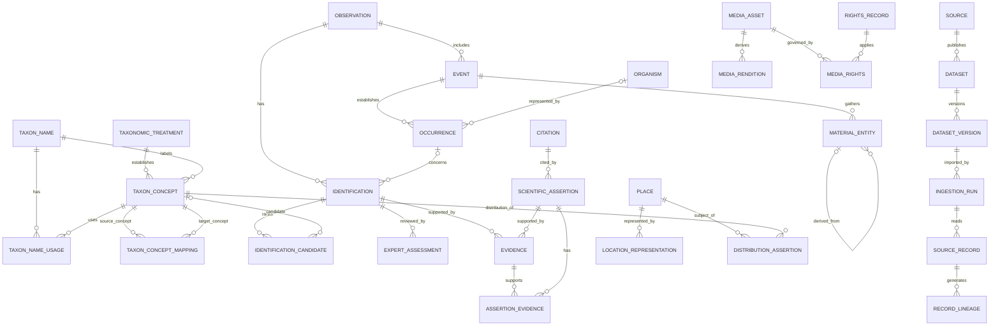

# TASK 05C — Logical Database Model and Scientific Data Relationships

**Project:** Botanica Indica — Save Tiger First  
**Document type:** Logical data architecture specification  
**Version:** 0.1 — Proposed for review  
**Status:** Draft; not an approved physical schema  
**Depends on:** Task 05 Data Architecture; Task 05B Scientific Data Dictionary and Indian Test Cases; ADR-004 through ADR-010; proposed ADR-011

---

## 1. Purpose and scope

This document converts the scientific data dictionary into a reviewable logical relational model. It defines entity boundaries, identifiers, relationships, cardinalities, lifecycle rules, integrity constraints, temporal behaviour, and the intended mapping to biodiversity standards.

It is deliberately **not** a PostgreSQL DDL specification. It does not select final column types, partitioning, indexes, deployment topology, ORM, migration framework, or a taxonomic backbone. Those decisions follow logical-model review and representative-data testing.

The model must support:

- taxonomic names and source-specific taxonomic concepts;
- taxonomic treatments and historical determinations;
- field observations, events, occurrences and physical material;
- multiple and competing identifications;
- evidence, citations, scientific assertions and expert assessments;
- media assets, rights and permitted purposes;
- source datasets, versions, ingestion runs and transformation lineage;
- geographic assertions and sensitive-location protection;
- exports and mappings to Darwin Core and TCS.

## 2. Design principles

1. **Separate the real-world thing from statements about it.** An observation, occurrence, identification, taxonomic concept and scientific assertion are not interchangeable.
2. **Preserve source opinions.** Never overwrite one authority's taxonomic or distribution statement with another's.
3. **Make assertions attributable.** A meaningful scientific claim has an agent or source, time, evidence/citation and review state where applicable.
4. **Keep history.** Corrections create new versions or assertions; they do not erase the historical record.
5. **Treat rights as data.** Access, display, redistribution, commercial use and AI training are separate permissions.
6. **Separate precise and public locations.** Public generalization must not destroy the restricted source coordinate.
7. **Use stable internal identifiers.** External identifiers are source-scoped mappings, not primary keys.
8. **Use standards as exchange contracts.** Darwin Core and TCS inform the model and mappings; neither is forced to become the complete internal schema.
9. **Avoid premature microservices.** Logical boundaries are not a requirement to deploy separate services or databases.
10. **Prefer explicit relationships over overloaded polymorphic tables.** Use junction entities where relationships carry attributes, provenance or lifecycle.

## 3. Conceptual architecture

The model is organized into bounded logical areas:

- **Taxonomy:** TaxonName, TaxonomicTreatment, TaxonConcept, TaxonNameUsage, TaxonConceptMapping.
- **Field records:** Observation, Event, Organism, Occurrence, MaterialEntity.
- **Identification:** Identification, IdentificationCandidate, IdentificationRun, ExpertAssessment.
- **Evidence and knowledge:** Evidence, ScientificAssertion, Citation, AssertionEvidence.
- **Media and rights:** MediaAsset, MediaRendition, RightsRecord, PermittedPurpose, MediaRights.
- **Sources and ingestion:** Source, Dataset, DatasetVersion, IngestionRun, SourceRecord, RecordLineage.
- **Geography:** Place, LocationRepresentation, DistributionAssertion, GeographicEvidence.
- **Governance:** Agent, Organization, ReviewDecision, AuditEvent.

A single logical database may initially contain these areas, while code modules enforce ownership and permitted dependencies.

## 4. Entity relationship overview

The following diagram is logical, not a physical schema. Optionality and associative entities are specified in later sections.

The diagram intentionally omits several junctions and governance relationships to remain readable. The detailed rules below are authoritative where the diagram appears simplified.

## 5. Identifier and key strategy

### 5.1 Internal identifiers

Use opaque, globally unique internal identifiers for primary entities. UUIDv7 is a candidate because it offers useful time ordering while retaining distributed uniqueness; ULID or another well-supported identifier may be evaluated. The final choice belongs in a separate implementation decision.

Requirements:

- IDs are immutable and never recycled.
- IDs do not encode scientific meaning, geography, source or user identity.
- IDs are generated by the platform, not copied from external datasets.
- Public APIs may expose opaque IDs but must not expose sensitive sequential internals.
- Junction records with their own provenance or lifecycle receive their own IDs.

### 5.2 External identifiers

Store external identifiers in source-scoped crosswalks, not as the internal primary key. Recommended generic structure:

- `external_identifier_id`
- `entity_type`
- `internal_entity_id`
- `source_id`
- `external_id`
- `external_uri` (nullable)
- `identifier_status`
- `valid_from`, `valid_to`
- `recorded_at`

Enforce uniqueness on the appropriate source + external identifier + entity type combination. Do not assume identifiers are globally unique across providers.

### 5.3 Natural keys

Scientific names, accepted-name strings, collector numbers, observation codes and source record IDs are not safe global primary keys. They may be duplicated, corrected, reused or interpreted differently by different sources.

## 6. Taxonomy domain

### 6.1 TaxonName

Represents a nomenclatural or taxonomic name string and its nomenclatural metadata. It does not, by itself, define the circumscription of a taxon.

Core relationships:

- one TaxonName may have many TaxonNameUsage records;
- one TaxonName may label many TaxonConcept records in different treatments;
- one TaxonName may have nomenclatural relationships to other names (for example, basionym or replacement-name relationships), represented by typed name-to-name relations;
- a name may be unplaced, unresolved, illegitimate, invalidly published or otherwise have a status requiring source context.

Do not put a single global `accepted_name_id` on TaxonName. Acceptance is treatment-specific.

### 6.2 TaxonomicTreatment

Represents the source or treatment in which taxonomic opinions are expressed. It should reference a Citation or bibliographic resource and retain:

- treatment identifier;
- publisher/author or responsible organization;
- publication date or version;
- persistent identifier or URL where available;
- access date and source snapshot;
- taxonomic scope and geographic scope where known;
- source license and permitted uses;
- import/retrieval metadata.

A treatment may be a flora, monograph, checklist, database release, expert determination or other identifiable taxonomic work. A personal communication should be represented carefully and with appropriate access controls.

### 6.3 TaxonConcept

Represents a taxonomic circumscription according to one treatment. A TCS-aligned concept must have exactly one TaxonName and exactly one according-to treatment/resource. This is a critical integrity rule.

Relationships:

- each TaxonConcept has one TaxonName;
- each TaxonConcept has one TaxonomicTreatment (or a treatment-resource abstraction that resolves to one source);
- a TaxonomicTreatment may establish many TaxonConcepts;
- a TaxonName may be used by many TaxonConcepts across treatments;
- concept-to-concept mappings are explicit, sourced and typed (for example congruent, included-in, includes, overlaps, excludes, or unresolved), with vocabulary mapped to the applicable TCS terms.

Do not merge two concepts merely because their labels are identical.

### 6.4 TaxonNameUsage

Represents a name used in a particular source record, observation determination, dataset, publication or taxonomic treatment. It records the exact usage string and context, and may resolve to a TaxonName and/or TaxonConcept after reconciliation.

This preserves the distinction between what a source said and what the current platform believes the source intended.

### 6.5 Taxonomic relationships

Use explicit typed relationship records for:

- basionym / combination / replacement-name relations between names;
- synonym usage of a name under a concept;
- parent-child taxonomic hierarchy within a treatment;
- concept mappings between treatments;
- misapplied-name or ambiguous usage where evidenced.

Do not represent every relationship as an untyped generic edge. Each relationship needs direction, source, evidence, asserted-by agent, date and status.

### 6.6 Taxonomy history

A new taxonomic treatment or changed reconciliation creates a new record or mapping version. Historical observations and identifications must retain the concept/name usage that was asserted at the time. Current accepted-name displays may be derived views, not destructive rewrites.

## 7. Field record domain

### 7.1 Observation

A contributor-submitted record describing an encounter, field note or documented observation. An Observation is not itself proof of a taxon identity or a formal occurrence determination.

Required logical attributes:

- internal observation ID;
- observer/agent (or privacy-preserving attribution);
- observed-at date/time or interval, with precision and timezone metadata;
- created-at and updated-at timestamps;
- submission channel and protocol where relevant;
- record status and moderation state;
- notes and visibility policy;
- consent and rights references;
- links to one or more Events, media assets and proposed identifications.

An observation may exist without an identification or precise location.

### 7.2 Event

Represents an action or set of circumstances at a location over a period, such as a field visit, photograph capture, collection event or survey. An Observation may group multiple Events. An Event may have one or more associated Occurrences and MaterialEntities.

Do not force all records to have a single timestamp. Preserve event start/end, date precision and uncertainty.

### 7.3 Organism

Represents an individual organism or defined group considered taxonomically homogeneous where tracking such an entity is useful. It is optional for many citizen-science records. Do not create a persistent Organism record merely because a user submitted one photograph.

### 7.4 Occurrence

Represents evidence/assertion of an organism's presence or state at a place and time. It is distinct from the Observation container, Event, Organism and MaterialEntity.

An Occurrence may be supported by a human observation, a specimen, a camera image or another basis of record. It may have zero or more identifications over time. A record with uncertain taxonomic identity may still be a valid occurrence at a higher taxonomic level or unresolved level.

### 7.5 MaterialEntity

Represents physical material such as a whole specimen, plant part, herbarium sheet, seed, tissue sample or derived sample. It is not synonymous with a digital photograph. It may be gathered during an Event and may be evidence for an Occurrence or Identification.

A MaterialEntity may be derived from another MaterialEntity. Such derivation is a directed, typed relationship and must preserve the source material and processing provenance.

### 7.6 Observation, Event, Occurrence and MaterialEntity cardinalities

- Observation: zero-to-many Events.
- Event: zero-to-many Occurrences.
- Event: zero-to-many MaterialEntities.
- Occurrence: zero-or-one Organism in the initial logical model; review whether group/aggregate cases require a more flexible association.
- MaterialEntity: zero-to-many derived MaterialEntities.
- Observation: zero-to-many Identifications.
- Occurrence: zero-to-many Identifications.
- No rule requires every Observation to create an Occurrence, Organism or MaterialEntity.

The export mapping must follow Darwin Core's event/occurrence/material-entity semantics, not simply rename internal tables.

## 8. Identification domain

### 8.1 Identification

An Identification is an attributable assertion that an Observation, Occurrence or MaterialEntity is associated with a taxon name/concept at a stated taxonomic level.

It must retain:

- subject and subject type;
- asserted taxon name and/or taxon concept;
- identifying agent (person, organization or model);
- identification date;
- identification method and protocol;
- status (proposed, current, superseded, withdrawn, disputed);
- confidence information if generated by a model;
- taxonomic rank and qualifier (for example cf., aff., genus-level);
- supporting evidence and citations;
- source model/version or expert credentials where relevant.

Avoid a single mutable `identified_species_id` on Observation.

### 8.2 IdentificationCandidate

Represents a candidate generated by an identification run or supplied by a human reviewer. Candidate ranking is not a taxonomic determination.

Store rank/order, model score and score semantics, candidate concept/name, evidence links, and run ID. Scores from different models or versions are not automatically comparable.

### 8.3 IdentificationRun

Represents one reproducible execution of an identification pipeline. Record model and pipeline versions, configuration, input media IDs/hashes, preprocessing versions, geographic/context features used, execution time, software/container digest, and outcome.

### 8.4 ExpertAssessment

Represents an expert's review of an identification or evidence set. It must record reviewer identity/credential context, decision, rationale, timestamp, conflicts of interest if declared, and the exact identification/evidence version reviewed.

An expert assessment does not erase prior assessments or automatically establish universal truth. Disagreement is a first-class state.

## 9. Evidence and scientific assertion domain

### 9.1 Evidence

Evidence is a typed resource or observation supporting, contradicting or contextualizing an assertion. Examples include a media asset, physical specimen, field measurement, diagnostic character, literature citation, expert statement or geographic record.

Use an AssertionEvidence association with:

- evidence ID;
- assertion/identification ID;
- support polarity (supports, contradicts, contextualizes);
- evidential role;
- explanation;
- contributor/source;
- date and provenance.

### 9.2 ScientificAssertion

Represents a sourced claim about a taxon, place, trait, habitat, distribution, phenology, conservation status or other botanical property.

An assertion should include:

- subject entity and typed subject relation;
- predicate/claim type;
- value or structured value;
- scope (geographic, temporal, life-stage or taxonomic);
- source/treatment;
- asserted-by agent;
- valid-time interval (when the claim is considered true);
- transaction/recorded-time interval (when the platform stored it);
- evidence and citations;
- review status and confidence/quality metadata where meaningful.

Do not store contradictory source statements in a single overwritten field. Present a curated view only after an explicit reconciliation decision.

### 9.3 Citation

Represents a bibliographic resource or stable source reference. Support DOI, ISBN, ISSN, repository identifier, URL, page/figure/table/section locator, author, title, publication date, publisher and retrieval date as applicable.

A URL alone is not a complete citation where a stable bibliographic identity exists.

## 10. Media and rights domain

### 10.1 MediaAsset

Represents a digital file or externally hosted media resource. Keep the asset separate from the biological MaterialEntity it depicts.

Store content hash, media type, file size, dimensions, capture metadata where permitted, uploader/contributor, created time, storage location, processing status, and visibility/security classification.

### 10.2 MediaRendition

Represents a derived thumbnail, crop, resized image, preview or transformed file. Every rendition must link to its parent asset and record transformation parameters/software version. A derivative does not automatically inherit every permission unless the governing rights allow it.

### 10.3 RightsRecord and MediaRights

Rights are asset- and purpose-specific. A rights record should capture rights holder, license/permission instrument, attribution text, source, allowed purposes, prohibited purposes, redistribution status, commercial-use status, AI-training status, derivative permissions, territory, validity dates, evidence of permission and review status.

Use a MediaRights association rather than one license string on the MediaAsset. The same asset may have multiple applicable rights constraints, and the effective permission is the intersection of applicable grants and restrictions.

A missing or ambiguous AI-training permission must resolve to **not authorized**, not to implied consent.

## 11. Source, dataset and ingestion domain

### 11.1 Source

Represents an institution, repository, database, publication provider or contributor source. Store source identity, organization, access method, contact, terms, attribution requirements, license policy, permitted use, rate limits and review date.

### 11.2 Dataset and DatasetVersion

A Dataset represents a published collection. DatasetVersion is an immutable snapshot or identifiable release. Store version label, publication/release date, retrieval date, checksum where feasible, source schema/standard version, rights snapshot and citation.

### 11.3 IngestionRun

Represents one execution of import/normalization/reconciliation. Record source and dataset version, start/end, software/config version, operator, counts, warnings, rejected/quarantined records, logs and reproducibility metadata.

### 11.4 SourceRecord and RecordLineage

Preserve source-native record payload or a rights-compliant reference to it, source identifier, source version, import time and checksum. RecordLineage links derived platform records to one or more source records and records transformations, matching/reconciliation decisions and responsible software/operator.

Never overwrite source-native values with normalized values. Keep both and record the transformation.

## 12. Geographic domain

### 12.1 Place

Represents a named or coded geographic feature or administrative/ecological area (country, state/UT, district, protected area, biogeographic region, habitat area). Place is not a point coordinate.

### 12.2 LocationRepresentation

Stores one representation of a location with geometry, coordinate reference system, spatial precision, uncertainty, representation type, access classification, source and derivation method.

Potential representations:

- exact/private;
- generalized/public;
- grid/cell;
- administrative area;
- textual locality;
- uncertain/range.

A restricted exact coordinate and public generalized coordinate must be separate representations linked to the same location subject, with authorization checks. Do not simply overwrite exact coordinates with generalized ones.

### 12.3 DistributionAssertion

Represents a sourced claim that a taxon concept occurs, is native, endemic, introduced, naturalized, cultivated, invasive, extinct locally or otherwise associated with a geographic area during a defined period.

It must include taxon concept, place or geometry, distribution/status vocabulary, source, evidence, temporal scope, spatial scale and confidence/quality. Status is not a global boolean on TaxonName.

### 12.4 Spatial rules

- Use explicit coordinate reference systems and record source CRS.
- Validate coordinate ranges and geometry validity.
- Preserve uncertainty and precision; do not imply point accuracy where only an administrative region is known.
- Restrict sensitive species and private contributor locations by policy.
- Public map products must use an approved generalized representation.
- Spatial indexes and partitioning are physical-design decisions, not logical-model assumptions.

## 13. Temporal and historical model

The model should distinguish:

- **valid time:** when a fact/assertion applies in the real or scientific world;
- **recorded time:** when the platform recorded the fact;
- **source publication time:** when a source released the information;
- **retrieval time:** when STF obtained the source data;
- **review time:** when a reviewer assessed the record.

At minimum, important scientific assertions, identifications, taxonomic mappings, distribution statements and rights records need immutable history or explicit versioning.

A correction should create a new version/decision and mark the previous one superseded or withdrawn, preserving who changed it, when and why. Do not implement full bitemporal database machinery until query requirements are confirmed, but do not discard the information needed to reconstruct history.

## 14. Core integrity constraints

The following are mandatory logical constraints:

1. A TaxonConcept has exactly one TaxonName and one according-to treatment/resource.
2. A TaxonConcept cannot be treated as globally equivalent to another concept based only on matching name strings.
3. A TaxonNameUsage preserves the source's verbatim usage even after reconciliation.
4. An Identification must have an attributable agent and a subject; a model identification must reference a reproducible IdentificationRun.
5. Candidate ranking is not equivalent to a confirmed Identification.
6. An ExpertAssessment references the exact identification version reviewed.
7. An Occurrence has a temporal and geographic context, allowing uncertainty and partial information.
8. A MaterialEntity is distinct from a MediaAsset.
9. A derived MaterialEntity has a traceable source MaterialEntity and derivation event/provenance.
10. A ScientificAssertion has a source or attributable agent and an explicit claim type.
11. Contradictory assertions are retained; reconciliation is a separate, attributable decision.
12. Every imported record can be traced to a SourceRecord and DatasetVersion where the source provides them.
13. Every media asset has a rights state; unknown rights are not treated as open rights.
14. AI training requires an affirmative permission decision for the asset and intended use.
15. Public location output must not expose a restricted exact representation.
16. All timestamps use a consistent UTC storage convention while preserving original timezone/precision where supplied.
17. Deletion, withdrawal, anonymization and retention follow documented legal/privacy policy and must not silently break scientific provenance.
18. External identifiers are unique only within their documented namespace/source scope.

## 15. Relationship cardinality summary

| Parent | Child / association | Cardinality | Notes |
|---|---|---:|---|
| TaxonName | TaxonConcept | 1 : 0..N | A name can be used by multiple treatments |
| TaxonomicTreatment | TaxonConcept | 1 : 0..N | Each concept has one according-to treatment |
| TaxonConcept | TaxonConceptMapping | 1 : 0..N | Directed, typed, sourced mappings |
| Observation | Event | 1 : 0..N | An observation may group multiple events |
| Event | Occurrence | 1 : 0..N | Event context supports occurrence |
| Event | MaterialEntity | 1 : 0..N | Material gathered during event |
| Observation | Identification | 1 : 0..N | Multiple historical/competing IDs |
| Occurrence | Identification | 1 : 0..N | Identifications may target occurrence |
| Identification | Candidate | 1 : 0..N | Candidates belong to a run/identification context |
| Identification | ExpertAssessment | 1 : 0..N | Preserve reviewer disagreement |
| Assertion | Evidence | N : M | Through AssertionEvidence |
| Dataset | DatasetVersion | 1 : 1..N | Immutable releases |
| DatasetVersion | IngestionRun | 1 : 0..N | Repeated reproducible imports |
| IngestionRun | SourceRecord | 1 : 0..N | Records processed or quarantined |
| MediaAsset | MediaRendition | 1 : 0..N | Derived media |
| MediaAsset | RightsRecord | N : M | Through MediaRights |
| TaxonConcept | DistributionAssertion | 1 : 0..N | Source- and region-specific |
| Place | DistributionAssertion | 1 : 0..N | Geographic scope |

The cardinalities are proposed. In particular, Observation-to-Event and Occurrence-to-Organism need domain expert validation for survey, multi-plant and group observations.

## 16. Darwin Core and TCS interoperability

The internal model should map deliberately to standards rather than copy their fields indiscriminately.

### 16.1 Darwin Core

Potential mappings include:

- TaxonName/TaxonConcept → Darwin Core Taxon terms, including scientificName, taxonID, taxonConceptID and nameAccordingTo where appropriate;
- Observation/Event → Event and related terms;
- Occurrence → Occurrence;
- Organism → Organism;
- MaterialEntity → MaterialEntity and appropriate material extensions;
- Identification → Identification;
- LocationRepresentation/Place → Location and geographic terms;
- Citation/Source → associated references and dataset metadata.

The mapping must be versioned and tested against the current Darwin Core term list. Darwin Core distinguishes Organism, Occurrence and MaterialEntity; they must remain distinct in our internal model too.

### 16.2 Taxon Concept Standard

TCS mappings must preserve:

- TaxonConcept;
- required taxonName;
- required accordingTo resource;
- TaxonName;
- synonym name usage;
- TaxonConceptMapping relationships;
- nomenclatural type and name relationships where available.

Do not model synonymy as a generic edge between concepts when TCS defines synonym as a relationship from a TaxonConcept to a TaxonName.

### 16.3 Exchange contract

Create separate, versioned mapping specifications for:
- Darwin Core Archive export;
- GBIF-oriented occurrence publication;
- TCS JSON/RDF or other selected serialization;
- source-specific import adapters.

Do not promise GBIF publication until organization eligibility, dataset requirements, data quality and rights are reviewed.

## 17. Recommended initial logical modules

| Module | Owns | Must not own |
|---|---|---|
| Taxonomy | Names, treatments, concepts, mappings, usages | User authentication |
| Field Records | Observations, events, occurrences, organisms, material entities | Taxonomic authority |
| Identification | Runs, candidates, identifications, expert assessments | Source rights policy |
| Knowledge & Evidence | Assertions, evidence, citations | Raw identity credentials |
| Media & Rights | Assets, renditions, rights decisions | Biological taxonomic interpretation |
| Source Integration | Sources, datasets, versions, ingestion, lineage | Silent scientific acceptance |
| Geography | Places, location representations, distribution assertions | Unrestricted access to sensitive coordinates |
| Governance | Agents, review decisions, audit events | Domain-specific scientific conclusions |

These are code ownership boundaries initially, not a prescription for separate databases.

## 18. Representative end-to-end workflows

### Workflow A — Citizen observation with uncertain identity

1. User creates Observation.
2. User uploads one or more MediaAssets with rights and visibility metadata.
3. System creates an Event with capture/observation time and location precision.
4. System may create an Occurrence if the evidence supports a presence record.
5. IdentificationRun generates candidates.
6. IdentificationCandidate records model outputs and evidence.
7. If evidence is insufficient, no species-level Identification is promoted.
8. User may submit a proposed identification or request review.
9. ExpertAssessment is added if reviewed.
10. All state changes remain auditable.

### Workflow B — Herbarium specimen with multiple determinations

1. Source and DatasetVersion are registered.
2. Specimen is represented as MaterialEntity.
3. Collection event and locality are represented as Event and LocationRepresentation.
4. Verbatim label/name is preserved as TaxonNameUsage.
5. Each determination is stored as an Identification with determiner, date and cited treatment.
6. A newer determination supersedes the current display without deleting prior determinations.
7. The specimen image remains a MediaAsset with independent rights metadata.

### Workflow C — Conflicting distribution claims

1. Two sources publish differing native/introduced range assertions.
2. Each becomes a separate DistributionAssertion linked to its source/treatment and geographic scope.
3. Both are retained.
4. A curator may create a reconciliation assessment with rationale and evidence.
5. The user interface may display source-specific claims and a curated interpretation with its own provenance.
6. No global status flag overwrites the source assertions.

### Workflow D — AI training eligibility

1. MediaAsset is registered with source and uploader.
2. RightsRecord and MediaRights record permitted purposes.
3. Rights service evaluates intended purpose = model training.
4. Only explicitly authorized assets enter the eligible training manifest.
5. Manifest stores asset IDs, hashes, rights decision version and model/dataset release.
6. Revocation or expiry triggers re-evaluation and a documented response plan.

## 19. Acceptance tests before physical schema

The logical model is not ready for SQL design until it can represent all of these without semantic loss:

1. Same scientific name used by two different taxonomic treatments.
2. One source treats a name as accepted while another treats it as a synonym.
3. A source-native name usage remains available after reconciliation.
4. An observation exists with no identification.
5. One observation has multiple images and more than one event.
6. One occurrence has multiple historical identifications and reviewer disagreement.
7. A specimen has multiple determinations with determiner and date.
8. A material sample is derived from another material entity.
9. A photograph depicts a plant but is not itself a specimen/material entity.
10. Conflicting geographic status assertions coexist.
11. A sensitive exact coordinate is withheld from public outputs while a generalized representation is available.
12. An asset may be displayed but not redistributed or used for AI training.
13. A dataset is re-imported and the lineage to both ingestion runs is preserved.
14. A taxonomic concept mapping changes without rewriting historical identifications.
15. A source correction can be applied while retaining the original source snapshot and audit trail.

Each test should become an automated integration/contract test once the physical model is implemented.

## 20. Risks and unresolved design questions

The following must remain open until evidence or expert review resolves them:

- Should Observation and Event be one-to-one for the first mobile capture workflow, with support for more complex events later?
- Should Occurrence always be explicit, or can a simplified observation workflow defer occurrence creation until data curation?
- How should an observation involving several individual plants be represented?
- Which TCS concept-mapping vocabulary and serialization profile will be implemented first?
- Which taxonomic source(s) will be authoritative for each taxonomic group and use case?
- How will taxonomic treatment snapshots be retained when upstream services change?
- Which rights instruments and evidence are sufficient for each data source and media type?
- What is the retention policy for precise location, EXIF metadata and contributor identity?
- Which assertions need full bitemporal querying versus immutable event history?
- Which external identifiers and exchange profiles are mandatory for initial interoperability?

## 21. Recommended implementation sequence after review

1. Botanical/taxonomic expert review of Sections 6–9.
2. Data architect review of identifiers, cardinalities and temporal model.
3. Privacy/security review of Sections 10–12.
4. Rights/legal review of Section 10 and the licensing policy.
5. Validate all 15 acceptance scenarios with representative records.
6. Publish a reviewed logical ERD and data dictionary revision.
7. Produce PostgreSQL/PostGIS physical design and migration plan.
8. Implement constraints and migration tests.
9. Implement source import/export adapters and standards conformance tests.

## 22. Research and standards references

The following primary references inform this proposal. Verify current versions again when implementation begins.

1. TDWG, Darwin Core standard: https://www.tdwg.org/standards/dwc/
2. TDWG, current Darwin Core List of Terms (version issued 2026-10-13): https://dwc.tdwg.org/list/
3. TDWG, Darwin Core Conceptual Model: https://dwc.tdwg.org/cm/
4. TDWG, Darwin Core Quick Reference: https://dwc.tdwg.org/terms/
5. TDWG, Taxon Concept Standard: https://tcs.tdwg.org/
6. TDWG, TCS List of Terms: https://tcs.tdwg.org/terms/
7. GBIF, data publishing documentation: https://techdocs.gbif.org/en/data-publishing/
8. GBIF, survey and monitoring data publishing guide: https://docs.gbif.org/guide-publishing-survey-data/en/
9. PostgreSQL, constraints documentation: https://www.postgresql.org/docs/current/ddl-constraints.html
10. PostGIS, documentation: https://postgis.net/documentation/

## 23. Decision status

**Proposed, not accepted.**

This document is a logical-model proposal for multidisciplinary review. It does not authorize implementation of a physical database schema. Changes should be made after documented review, with unresolved assumptions retained rather than silently converted into facts.

The immediate next deliverable should be a **reviewed logical ERD plus a relational mapping and integrity-constraint specification**, followed by the PostgreSQL/PostGIS physical design only after the acceptance tests pass.
