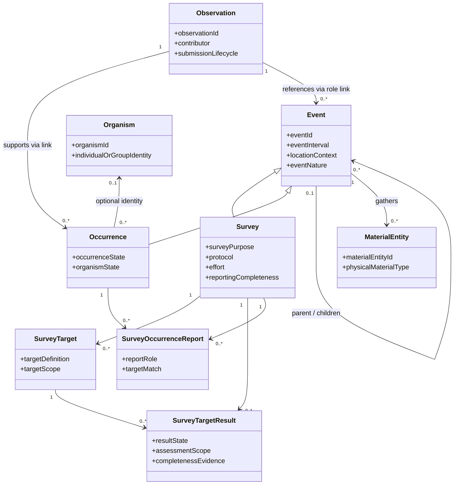

# Event–Survey–Occurrence Conceptual Model Decision Paper

**Document ID:** STF-BI-REV-FLD-001  
**Version:** 0.1 — Proposed for discipline and owner review  
**Prepared:** 21 November 2026  
**Status:** Proposed decision paper; no scientific model or physical schema approved  
**Repository:** `Save-Tiger-First/botanica-indica`  
**Review destination:** PR #9 — `review/scientific-data-model-review-pack`  
**Decision authority:** Save Tiger First project owner, informed by qualified field ecology, botanical, biodiversity-informatics and data-architecture review  
**Scope:** Internal semantics and cardinalities for Event, Survey, Occurrence, Observation, Organism, MaterialEntity and explicit non-detection; loss-aware Darwin Core mapping  
**Out of scope:** SQL/DDL, ORM, API payload freeze, survey protocol standardization, ecological inference thresholds, public data policy, final DwC/GBIF export profile selection

---

## 1. Executive conclusion

### 1.1 Recommendation

**Recommended design direction for review: a shared Event identity/supertype with Survey and Occurrence specializations, while keeping Botanica Indica's Observation as a separate contributor/workflow record.**

This is the best fit among the options reviewed because it:

1. follows the semantics described by the directly retrieved TDWG Darwin Core Conceptual Model (DwC-CM) version 2026-05-26, where Survey and Occurrence are special types of Event;
2. supports hierarchical monitoring programmes, repeated surveys, plot visits and nested field activities;
3. permits one contextual Event to provide shared spatial-temporal context to multiple Occurrences and MaterialEntities;
4. prevents the product's Observation submission from being conflated with a scientific Event or Occurrence;
5. provides a principled place to record explicit survey targets, protocol, effort and reporting completeness; and
6. permits loss-aware mappings without requiring Botanica Indica's internal schema to copy Darwin Core.

This is a **recommendation, not an approved model**. The DwC-CM is a high-level, non-normative conceptual framework (apart from its section describing document status); it does not prescribe a relational schema or require Botanica Indica to use identical internal entities.

### 1.2 Important refinement: non-detection

Do not equate any of the following:

- no Observation submitted;
- no Occurrence record stored;
- a Survey that did not report a target;
- an explicit result that a target was not detected under a defined Survey.

Only the last is a defensible non-detection result, and even that is not proof that the organism was absent from the entire area or period.

The proposed internal model should record a **SurveyTargetResult** (an internal Botanica Indica concept) for each assessed target and survey scope. A result of `not_detected` must be explicitly supported by the Survey context, target, method/protocol, effort where applicable, time/location and reporting-completeness evidence. The result must map to the selected Darwin Core/GBIF representation only after the target export profile is pinned and tested.

### 1.3 Current readiness

**Decision status: OPEN — blocking for Task 05E.**

No independent field ecologist, taxonomist, biodiversity-informatics specialist or database architect has signed off this design. No fixtures have been executed. This paper must not be treated as scientific approval, implementation authorization or closure of DR-07, B01, B02, B16, LDM-16 or FLD-08.

---

## 2. Documents inspected and exact revisions

The following files were fetched directly from the current GitHub branches on 21 November 2026. Blob SHAs identify the exact file contents inspected; branch heads and PR metadata were separately checked.

| Source | Branch / PR | File blob SHA |
|---|---|---|
| Task 05 — Data Architecture | `docs/task-05-data-architecture` / PR #3 | `a3255dcf2d1bd4dfa982b381b061051b6c2c8b0b` |
| Task 05B — Scientific Data Dictionary and Indian Test Cases | `docs/task-05-data-dictionary` / PR #4 | `eda2608e3d2281299d62ebf85bf16a2d2e796411` |
| Task 05C Candidate A — Logical Database Model | `docs/task-05c-logical-data-model` / PR #5 | `4a21c0aa3b8ebfef319a9ea1ac6928274b0b3f5b` |
| Task 05C Candidate B — Logical Database Model and Scientific Relationships | `docs/task-05c-logical-database-model` / PR #21 | `239d7e9974bcb81b1154b54845a7b2d69c3775d6` |
| Task 05D — Logical Model Validation v3 | `docs/task-05d-logical-model-validation-v3` / PR #11 | `cf0b9c10bcb2da7b102e52688f22bd8e8b69bb91` |
| Scientific Data Model Review Pack | `review/scientific-data-model-review-pack` / PR #9 | `c11f4b58d0908742474d3e58b4ec0aa3739f7b99` |
| Task 05C Competing Model Reconciliation | `review/scientific-data-model-review-pack` / PR #9 | `749be7ba7c832cf76e90141b5dd65fe573800912` |
| Scientific Data Model Validation Matrix and Decision Register | `review/scientific-data-model-review-pack` / PR #9 | `175ca5bf91cc7a09e5bfb808c488ec37a80a853c` |
| Workflow Lifecycle and State-Machine Specification | `docs/requirements-traceability-register` / PR #19 | `03ca940095a9e39c5608548bdeec1ce0166bf76d` |
| API Command, Idempotency and Conflict-Resolution Contract | `docs/requirements-traceability-register` / PR #19 | `6ffb50286c59449773caf574d4236d6e0b2208e0` |

### 2.1 Repository state at review

- PR #9 is open and draft; base `main`, head `review/scientific-data-model-review-pack`.
- PR #5 is open and draft; base `main`, head `docs/task-05c-logical-data-model`.
- PR #21 is open and draft; base `review/scientific-data-model-review-pack`, head `docs/task-05c-logical-database-model`.
- PR #11 is open and draft; it is stacked on PR #5's branch.
- PR #19 is open and draft; base `develop`.
- The repository has 23 branches and 20 open PRs at the time of verification.

No PR was merged or closed and no branch was deleted or created for this review.

---

## 3. Source-derived findings: where the existing documents differ

### 3.1 Task 05 — conceptual direction

Task 05 now describes:

- Observation as a field record submitted by a user, researcher or institution;
- Occurrence as a specialized Event that establishes an Organism's state at a place and time;
- Event as the contextual action/process/set of circumstances at a place and interval;
- Survey as a specialized Event;
- nested Events for monitoring programmes, repeated site surveys and plot visits;
- contextual Events/Surveys that may provide shared spatio-temporal context to multiple Occurrences and MaterialEntities; and
- an explicit recommendation to evaluate a shared Event identity/supertype with Survey and Occurrence specializations.

Task 05 also states that one Observation may support one or more Occurrence interpretations and one Occurrence may be supported by multiple sources/evidence records, but the exact cardinality remains open.

### 3.2 Task 05B — data dictionary

Task 05B currently defines separate logical records for Observation, Occurrence and Event. Its proposed Occurrence fields include an optional `event_id`, an optional Organism reference, an optional Location reference, explicit occurrence status and typed evidence links.

Its Event fields include an event type, optional parent event, interval, optional location, sampling protocol, sampling effort and responsible agent. Survey appears as an Event type, but there is no separately specified Survey specialization with a governed target/result model.

The document says a non-detection must be explicit and linked to a defined Survey/Event, protocol, effort, target and location. It correctly states that absence of an Occurrence row is not evidence of absence.

**Gap:** a generic Event row with `event_type = Survey` does not by itself specify which survey-specific fields are required, how target lists and repeated sampling work, how reporting completeness is recorded, or how target-specific results are represented.

### 3.3 Task 05C Candidate A — preferred review candidate, not approved

Candidate A distinguishes Observation, Occurrence and Event. It proposes:

- Event to Occurrence: one-to-many;
- Occurrence to Observation: many-to-many through an explicit link;
- Occurrence to MaterialEntity: many-to-many through an explicit link;
- optional Organism association; and
- Event to MaterialEntity collection context.

However, the ER diagram and relationship table do not yet model Occurrence as an Event specialization with shared identity. The Event-to-Occurrence relationship is drawn as a context relationship. It does not fully express the Darwin Core conceptual statement that an Occurrence is itself a type of Event. Survey is not a separately modelled subtype.

### 3.4 Task 05C Candidate B — useful alternative, not approved

Candidate B proposes:

- Observation to Event: one Observation may relate to zero or many Events;
- Event to Occurrence: one Event may relate to zero or many Occurrences;
- Event to MaterialEntity: one Event may relate to zero or many MaterialEntities;
- optional Organism association to Occurrence; and
- optional parent-child Event hierarchy.

Candidate B provides useful cardinality prompts and makes Observation-to-Event linkage more explicit. It still models Event and Occurrence as separate entities linked by a relationship, does not provide a dedicated Survey specialization/target-result model, and does not establish the required distinction between an Event hierarchy and the association by which a Survey reports an Occurrence.

**Recommendation:** retain Candidate B as a source of useful workflow/cardinality cases; do not merge it wholesale or treat its relationships as already validated.

### 3.5 Task 05D and the review pack

Task 05D and the review pack already identify the unresolved decisions:

- B01 — Observation–Occurrence cardinality and ownership;
- B02 — Event, Survey, plot and sampling hierarchy;
- B16 — internal non-detection semantics and external sampling-event mapping;
- DR-07 — Observation/Event/Occurrence semantics; and
- LDM-16 / FLD-08 — explicit non-detection and the rule that missing records do not imply absence.

Task 05D states that Task 05E is **NOT READY** and requires a field/ecology review, biodiversity-informatics review, reproducible fixtures and an explicit owner readiness decision.

### 3.6 Workflow and API constraints

The Workflow Lifecycle Specification correctly states that Observation, Event, Survey, Occurrence, Organism and MaterialEntity are distinct concepts and that exact relationships remain subject to Task 05 reconciliation.

The API contract correctly prohibits inferring non-detection from an absent Occurrence row and says Survey/non-detection commands are not ready for payload freeze. It must remain aligned with the final model; this paper does not authorize a Survey API command.

---

## 4. Authoritative standards evidence

### 4.1 Darwin Core Conceptual Model

The directly opened TDWG Darwin Core Conceptual Model page identifies the reviewed version as **2026-05-26** and provides a version-specific IRI:

`http://rs.tdwg.org/dwc/doc/cm/2026-05-26`

The model states that:

- Event is an action, process or set of circumstances occurring at a place during an interval.
- Events may be nested hierarchically. A child Event is contained within a parent Event, and an Event may have many children but only one parent.
- Occurrence, Organism Interaction and Survey are special types of Event with their own characteristics.
- A Survey is a type of Event. Complex surveys may be represented through an Event hierarchy, including repeated surveys, protocols, agents and sites.
- Survey results are expressed in the Occurrences it reports. These may be incidental/bycatch or match Survey Targets.
- Survey Targets may describe taxa, environmental conditions, organism traits or combinations.
- With sufficient supporting information, including Occurrences, quantities and reporting completeness, a Survey may support inference about absence of detection, abundance and change over time.
- An Occurrence is a type of Event and can represent direct observation, indirect inference, or absence of detection of an Organism of a given Taxon in a particular state during a defined interval at a Location.
- One contextual Event may provide shared spatio-temporal context to multiple activities, Occurrences and MaterialEntities.

**Important status limitation:** the DwC-CM explicitly labels its overview and thematic sections non-normative; all sections except the document-status section are non-normative. It is a semantic reference framework, not a mandated database schema. It expressly permits internal entities and relationships beyond the model and allows implementations to adapt cardinality where warranted.

Sources:
- https://dwc.tdwg.org/cm/
- Version-specific document: http://rs.tdwg.org/dwc/doc/cm/2026-05-26

### 4.2 Darwin Core List of Terms

The directly opened List of Terms page identifies version **2026-05-26**:

`http://rs.tdwg.org/dwc/doc/list/2026-05-26`

Relevant term semantics include:

- `dwc:Event` and `dwc:Occurrence` as classes;
- `dwc:eventCategory`, with recommended controlled values including `Event`, `MaterialGathering`, `Occurrence`, `OrganismInteraction` and `Survey`;
- `dwc:parentEventID` for event hierarchy;
- `dwc:samplingProtocol` and `dwc:samplingEffort`;
- `dwc:occurrenceStatus`, defined as a statement about detection or non-detection of an Organism during an Event, with recommended values `detected` and `notDetected`.

Do not treat `Survey` as a separate core `dwc:Survey` class solely because it is described as a special type of Event in the conceptual model. Use the actual term/vocabulary semantics and the appropriate extension/profile when mapping survey-specific properties.

Sources:
- https://dwc.tdwg.org/list/
- Version-specific document: http://rs.tdwg.org/dwc/doc/list/2026-05-26
- https://dwc.tdwg.org/terms/

### 4.3 Version discrepancy remains open

The repository's DR-09 records an inconsistency between indexed metadata reporting 2026-10-13 and directly rendered version headers/term snapshots reporting 2026-05-26. The directly opened Conceptual Model and List pages in this review both display 2026-05-26 and link to the version-specific IRIs above. A separate indexed result for the core `dwc:` term list reports 2026-10-13, while direct rendering of that page has also returned 2026-05-26.

This paper therefore pins the **directly inspected 2026-05-26 conceptual and List documents for this semantic analysis**. It does not close DR-09, claim that 2026-05-26 is necessarily the latest current publication, or replace the required comparison of exact versioned resources and term IRIs before production export mapping.

### 4.4 GBIF publishing guidance

GBIF distinguishes occurrence publishing from sampling-event publishing. Sampling-event datasets carry additional event, protocol and effort context, and negative occurrence information is meaningful only when survey effort and protocol are documented. The exact target profile and status vocabulary must be pinned at export implementation time.

Source:
- https://techdocs.gbif.org/en/data-publishing/data-quality-recommendations

GBIF publishing profiles are not internal database schemas. Internal validity, scientific completeness, rights eligibility and external publishing readiness remain separate.

---

## 5. Design alternatives

### Option A — Separate Event, Survey and Occurrence entities with direct links

**Description**

Keep Event, Survey and Occurrence as independent entities. Connect them with explicit foreign keys or link tables. A Survey references an Event; an Occurrence references an Event and may reference a Survey.

**Advantages**
- Minimal disruption to the current Task 05C entity separation.
- Straightforward to understand for teams unfamiliar with event specialization.
- Allows separate storage and lifecycle of survey metadata.

**Disadvantages / risks**
- Duplicates Event identity and risks duplicating time, location, agents and provenance across Event, Survey and Occurrence.
- Does not inherently express that Survey and Occurrence are specialized Event types.
- Can produce ambiguous relationships: is a Survey a type of Event, a child Event, a separate programme, or merely a container?
- Risks one-to-many assumptions that do not capture parent/child hierarchies or shared contextual Events.
- Requires a more complicated and potentially lossy export mapping.

**Assessment:** workable only if a rigorously specified shared identity or loss-aware mapping is added. A plain three-independent-entity design is not recommended.

### Option B — Event supertype with Survey and Occurrence specializations

**Description**

Use one Event identity and common event attributes. Survey and Occurrence are specialized records sharing the Event identity, with subtype-specific attributes. A generic Event may also represent a project, site visit, collection event, deployment or other contextual activity.

**Advantages**
- Directly expresses the DwC-CM semantic relationship without requiring identical table names.
- Avoids duplicate event identity, date, location and agent data.
- Supports parent/child Event hierarchy.
- Supports shared context for many Occurrences and MaterialEntities.
- Provides a natural place for Survey-specific target, protocol, effort and reporting-completeness metadata.
- Makes explicit non-detection a bounded Survey result rather than an absence inferred from missing records.

**Disadvantages / risks**
- Requires clear subtype integrity rules and careful API/read-model representation.
- Requires a decision about single-table inheritance versus shared-primary-key subtype tables or another equivalent pattern; that is a physical-design choice and remains out of scope.
- Requires care where one Event is multi-faceted or provides shared context to several activities.
- Survey-specific result semantics require their own controlled model and validation.

**Assessment:** **preferred design direction for review.**

### Option C — Event as a contextual container; Occurrence and Survey as fully separate domain records

**Description**

Keep Event as a context record, with separate Occurrence and Survey domain entities linked to one or more Events. The mapping layer treats them as Event specializations when exporting.

**Advantages**
- Can preserve internal domain distinctions where Observation, Survey and Occurrence need independent workflows.
- Allows multiple contextual Events to relate to one domain record if explicitly required.
- Avoids requiring all domain entities to inherit Event behavior internally.

**Disadvantages / risks**
- The internal model no longer directly expresses the Event-specialization semantics; the mapping layer must reconstruct them.
- Shared date/location/agent attributes can be duplicated or inconsistently overridden.
- Requires explicit rules for which context is authoritative and how multiple contexts are reconciled.
- Increases mapping and validation complexity.

**Assessment:** viable fallback only if Option B proves incompatible with concrete domain requirements and a loss-aware mapping is demonstrated with fixtures. It should not be selected merely to avoid modelling subtype identity.

### 5.1 Comparative evaluation

| Criterion | Option A | Option B | Option C |
|---|---|---|---|
| Expresses Survey/Occurrence as Event specializations | Weak unless augmented | Strong | Mapping-layer only |
| Avoids duplicated event context | Weak | Strong | Moderate |
| Supports nested monitoring hierarchy | Possible, needs explicit design | Natural | Possible, more links |
| Supports one context Event for many Occurrences/materials | Possible | Strong | Strong |
| Keeps product Observation separate | Yes | Yes | Yes |
| Survey target/result semantics | Must be added | Fits as Survey specialization | Must be added separately |
| Mapping complexity | High | Moderate | High |
| Fit with reviewed DwC-CM semantics | Indirect | Closest conceptual fit | Indirect but possible |
| Recommendation | Not preferred | **Preferred** | Fallback if justified |

---

## 6. Recommended conceptual model

### 6.1 Core entities

1. **Event** — shared identity and common context for an action, process or set of circumstances at a place during an interval.
2. **Survey** — a specialized Event with survey-specific purpose, target, protocol, effort and reporting-completeness information.
3. **Occurrence** — a specialized Event representing a state/detection context for an Organism or taxon-target at a place and time; it may represent detection, indirect inference or a supported non-detection result.
4. **Observation** — Botanica Indica's contributor-submitted record/workflow container. It is not automatically an Event or an Occurrence.
5. **Organism** — an individual or defined taxonomically homogeneous group where identity is meaningful and supported. Do not create an individual Organism record for every photograph.
6. **MaterialEntity** — physical matter gathered or sampled during an Event; distinct from a digital MediaAsset.
7. **SurveyTarget** — internal declaration of what the Survey sought, such as a taxon/concept/group, trait, habitat condition or environmental target.
8. **SurveyTargetResult** — internal, attributable result for a particular Survey and target/scope, with explicit result state and completeness evidence. This is a proposed internal entity, not a claim that Darwin Core defines a core class with this exact name.
9. **ObservationEventLink** — explicit association between a platform Observation and one or more Events, with role/provenance.
10. **ObservationOccurrenceLink** — explicit association between a platform Observation and one or more Occurrences it documents or supports.
11. **SurveyOccurrenceReport** — explicit association recording which Occurrences a Survey reports, including whether they match a target or are incidental/bycatch.
12. **EventContextLink** — optional, typed contextual association for cases where one parent Event is insufficient to express a legitimate secondary context. Use only if real fixtures demonstrate the need; do not introduce this as a default generic relationship.

### 6.2 Proposed cardinalities

These are **proposed review cardinalities**, not approved schema constraints.

| Relationship | Proposed cardinality | Rule / qualification |
|---|---|---|
| Event → parent Event | Child Event has 0..1 parent; parent has 0..* children | Supports nested programme, repeated survey and plot-visit structure. A child has one parent in the core hierarchy. |
| Event → Survey specialization | Event has 0..1 Survey specialization; each Survey shares exactly one Event identity | A Survey is an Event with additional target/protocol/result semantics. |
| Event → Occurrence specialization | Event has 0..1 Occurrence specialization; each Occurrence shares exactly one Event identity | An Occurrence is an Event, not merely a record attached to a generic Event. |
| Survey → SurveyTarget | 0..* targets; each SurveyTarget belongs to one Survey | A broad inventory may have no explicit predeclared target; absence inference requires an explicit target or a justified post-hoc target. |
| Survey → SurveyTargetResult | 0..* results; each result belongs to one Survey and one target/scope | One result per target and defined survey scope/period; repeated visits should have distinct Survey/target results where appropriate. |
| Survey → reported Occurrence | 0..* through SurveyOccurrenceReport | Includes target-matching detections and incidental/bycatch Occurrences. |
| Occurrence → reporting Surveys | 0..* through SurveyOccurrenceReport | Permit multiple survey reports only where the same occurrence/event can legitimately be reported by multiple contexts and provenance is preserved; otherwise create separate Occurrences. |
| Event → MaterialEntity gathered | 0..* MaterialEntities | A contextual collection Event may gather multiple physical materials. Retain collection/derivation provenance. |
| Organism → Occurrence | One Organism to 0..* Occurrences; each Occurrence has 0..1 Organism in the initial model | Individual/group identity is optional when unknown or not meaningful; revisit for plant clonal colonies and aggregate records. |
| Observation → Event | 0..* through ObservationEventLink | Role identifies capture activity, survey participation, contextual reference or other reviewed relationship. No fabricated Event when context is unavailable. |
| Observation → Occurrence | 0..* through ObservationOccurrenceLink | One submission may document multiple plant/organism occurrences; an Occurrence may have multiple supporting submissions. |
| Occurrence → MaterialEntity | 0..* through evidence/collection relationship | Physical material is not the Occurrence itself. |
| Event → Location context | One semantic location context; precision/geometry may be unknown or withheld | A withheld or unknown location state is explicit; do not invent a coordinate. |

### 6.3 Event hierarchy versus Survey reporting

Do not collapse these into one relationship:

- **Parent Event hierarchy:** describes temporal/spatial containment (e.g. monitoring programme → annual survey → plot visit).
- **SurveyOccurrenceReport:** describes that a Survey reports an Occurrence as a result (target-matching or incidental).
- **ObservationEventLink:** describes how a contributor submission relates to an Event.
- **ObservationOccurrenceLink:** describes how a submission contributes evidence to an Occurrence interpretation.

A Survey may be a parent Event for multiple child Events, and its results may be expressed through multiple Occurrences. These relationships may overlap but do not mean the same thing.

The Event hierarchy follows the reviewed DwC-CM guidance that a child Event is contained within one parent Event. If a real workflow requires more than one contextual association, use a separately typed, provenance-bearing association rather than allowing multiple parent IDs without defined semantics.

### 6.4 Observation is not a Darwin Core Event by default

The platform's Observation record is a contribution/workflow object. It may contain notes, media, contributor details, rights status, review status and correction history.

It may link to:
- a capture/field Event;
- a Survey in which the contributor participated;
- one or more Occurrences documented by the submission;
- no Event yet, where time/place/activity context is incomplete or unknown.

Do not assume every Observation is a `dwc:HumanObservation`, `dwc:Event` or `dwc:Occurrence`. Select external mappings from the actual evidence and purpose. Do not set `basisOfRecord` by copying the platform entity name.

### 6.5 Event location and time

The reviewed DwC-CM describes Events as occurring at a Location, even where the Location is unknown or not shared. Botanica Indica should preserve this semantic context without fabricating coordinates:

- known precise location;
- known generalized/administrative location;
- uncertain location or area;
- withheld/restricted location;
- unknown/not recorded location.

Likewise, preserve the precision of the time interval. A year-only or month-only record must not be expanded into an exact timestamp.

---

## 7. Explicit non-detection model

### 7.1 Required distinction

Use distinct internal outcomes:

| Result | Meaning | May support non-detection? |
|---|---|---|
| `detected` | Target was detected; one or more Occurrence records should evidence it | No; it is a detection |
| `not_detected` | Target was sought under a defined survey scope and was not detected | Yes, subject to evidence/completeness |
| `not_assessed` | Target was not evaluated | No |
| `incomplete` | Reporting or survey coverage is incomplete | No |
| `indeterminate` | Evidence or method does not support a defensible result | No |
| No result record | No statement has been made | No |

These are proposed internal values. They must be reviewed against the eventual controlled vocabulary and mapped explicitly to external terms.

### 7.2 Minimum evidence for `not_detected`

A `not_detected` SurveyTargetResult must identify:

1. the Survey and the scope/period to which the result applies;
2. the target sought (taxon/concept/group, trait or other defined target);
3. the relevant location or explicit unknown/withheld location context;
4. the time interval and its precision;
5. the protocol/method and version, where applicable;
6. the effort and unit, or a documented explanation of why a quantitative effort value is not applicable;
7. the responsible Agent(s), device or method where relevant;
8. whether reporting for the target and survey scope is complete;
9. evidence, source and provenance for the result; and
10. any limitations that affect interpretation.

A result cannot be `not_detected` if the survey was not conducted, the target was not assessed, reporting was incomplete, or the relevant evidence is insufficient. In those cases use `not_assessed`, `incomplete` or `indeterminate` as appropriate.

### 7.3 Avoid ecological overclaim

`not_detected` means not detected under the specified method, effort, place, time and reporting scope. It does **not** establish:
- biological absence throughout the wider locality;
- extinction or local extirpation;
- absence outside the survey interval;
- absence under other protocols or detection conditions; or
- a zero population estimate.

Any ecological inference beyond the observation of non-detection requires an appropriate study design, detectability assumptions and specialist review.

### 7.4 Darwin Core mapping

The directly reviewed Darwin Core term definition for `dwc:occurrenceStatus` is a statement about detection or non-detection of an Organism during an Event; the recommended values include `detected` and `notDetected`.

The internal `SurveyTargetResult` should map to a Darwin Core Occurrence/event representation with `occurrenceStatus = notDetected` only where the selected export model/profile supports that mapping and all required context is present. Do not map `not_assessed`, `incomplete`, `indeterminate` or a missing result to `notDetected`.

GBIF sampling-event guidance and the target profile's vocabulary must be checked separately. Do not assume Darwin Core's recommended literal values and a publisher's profile-specific values are interchangeable.

---

## 8. Worked workflows and expected representation

### WF-FLD-01 — Single plant photograph, uncertain context

A contributor uploads two photographs of one flowering shrub. The date is known to the day, but the location is uncertain. AI returns several candidates and the contributor selects “not sure”.

Expected representation:
- one Observation contribution;
- one or more MediaAssets, subject to rights and privacy checks;
- optional capture Event only if a defensible activity/time/location context can be recorded;
- no forced Occurrence if the evidence does not yet support an occurrence interpretation;
- no forced Organism identity;
- no Identification promoted from AI candidates;
- explicit uncertainty and provenance.

### WF-FLD-02 — One photograph shows several plants

A contributor photographs three distinct plants in one frame.

Expected representation:
- one Observation submission may document multiple Occurrences if evidence supports distinct occurrence interpretations;
- each Occurrence has its own Event identity and state;
- the Occurrences may share a contextual capture Event or parent Event;
- do not assume one plant per photo or create Organism identities without evidence;
- preserve the media link to the Observation and relevant Occurrences.

### WF-FLD-03 — Repeated plot survey

A team monitors a fixed plot monthly for two years.

Expected representation:
- a parent monitoring-programme Event;
- repeated Survey Events (or a parent Survey and child Survey Events, if the survey design justifies that structure);
- plot visits represented as child Events with their own time interval, agents, protocol and effort;
- each visit can report multiple Occurrences;
- SurveyTargets and target-specific results are recorded for the appropriate visit/scope;
- a `not_detected` result is allowed only where the target was assessed and reporting completeness is established;
- no Occurrence row for a target with no result remains unknown, not absent.

### WF-FLD-04 — One contextual event, multiple occurrences and material entities

A botanical expedition at a site records several plants and collects two specimens.

Expected representation:
- one contextual Event with place/time/agents;
- multiple Occurrence Events as child Events or linked activities;
- multiple MaterialEntities gathered during the contextual Event;
- each Occurrence may have independent evidence/identifications;
- specimen and media assets remain distinct;
- a MaterialEntity may provide evidence for an Occurrence without becoming that Occurrence.

### WF-FLD-05 — Herbarium specimen record imported later

A herbarium specimen is digitized long after collection.

Expected representation:
- collection Event with historical date precision and locality evidence;
- MaterialEntity for the physical specimen;
- separate digitized MediaAsset;
- imported source record and provenance;
- one or more historical Identifications;
- platform Observation may not exist at all;
- no fabricated contributor Observation or new collection Event.

### WF-FLD-06 — Survey with incidental/bycatch observations

A pollinator-focused survey records a plant species that was not an explicit target.

Expected representation:
- Survey with declared targets and protocol;
- an Occurrence reported by the Survey with report role `incidental`/bycatch;
- no false assertion that the plant was a SurveyTarget;
- survey reporting completeness interpreted separately for declared targets and incidental records.

### WF-FLD-07 — Incomplete survey

A survey team leaves a plot early due to weather and does not complete the target checklist.

Expected representation:
- Survey and actual effort recorded;
- target result `incomplete` or `indeterminate`, not `not_detected`;
- any detections already made remain valid Occurrences;
- no absence inference for uncompleted targets.

### WF-FLD-08 — No observation or survey result

A locality has no stored Occurrence for a taxon.

Expected representation:
- no claim of absence;
- no synthetic negative record;
- absence of a record remains unknown/not recorded.

---

## 9. API and workflow implications

This paper does not authorize API implementation. It does establish constraints for later contract design.

1. `observation.create` must create a platform Observation without forcing an Event, Occurrence, Organism or taxon.
2. If Event context is supplied, the command must identify the relationship role and must not silently equate Observation with Event.
3. A Survey must not be created as a generic Event with no way to preserve survey-specific target/protocol/effort/completeness semantics.
4. SurveyTarget and SurveyTargetResult commands should remain deferred until the model and authority policy are approved.
5. A detected Survey result should reference its Occurrence evidence; a non-detected result must be explicit and bounded.
6. A missing Occurrence row must never be converted to `notDetected`.
7. An API read model may present Observation, Event, Survey and Occurrence together, but must preserve their distinct identities and statuses.
8. Offline synchronization must preserve event hierarchy and stable client references without silently merging repeated plot visits or separate Occurrences.
9. Expert determination and scientific review remain independent of Survey/Observation lifecycle.
10. Export mappings must be versioned and profile-specific; an internally valid record may be non-publishable.

---

## 10. Required validation scenarios

These scenarios extend the existing LDM-01–LDM-16 and FLD-01–FLD-08 suite; they do not replace or renumber it. They are acceptance proposals, not executed tests.

| Proposed ID | Scenario | Required result |
|---|---|---|
| EVT-01 | One monitoring programme contains multiple repeated Surveys | Parent/child hierarchy retains each Survey's distinct identity, time, place, agent and protocol. |
| EVT-02 | One Survey reports multiple target-matching Occurrences | SurveyOccurrenceReport preserves all Occurrences and target relation. |
| EVT-03 | One Survey reports incidental/bycatch Occurrence | Report role records incidental result without adding it to the target list. |
| EVT-04 | One contextual Event supports several Occurrences and MaterialEntities | Shared context is represented once; no duplicated/conflicting time/location data. |
| EVT-05 | One Observation documents three plants | One Observation can link to three supported Occurrences; no one-photo/one-plant assumption. |
| EVT-06 | One Occurrence is supported by multiple Observation submissions | Evidence/provenance links retain all contributors and their roles. |
| EVT-07 | One Observation has no known Event context | Observation remains valid; no fabricated Event/date/location. |
| EVT-08 | A Survey has no predeclared targets | Survey remains valid as an inventory; no target-specific non-detection is inferred without a defined target and assessment. |
| EVT-09 | SurveyTargetResult = not_detected with complete protocol/effort/reporting | Explicit bounded non-detection is retained and can be mapped to the pinned target profile. |
| EVT-10 | Survey target is not assessed | Result is not_assessed; no negative Occurrence is generated. |
| EVT-11 | Survey is incomplete due to weather/access | Result is incomplete/indeterminate; no not_detected state. |
| EVT-12 | Same taxon is not detected in one visit but detected in a later visit | Separate target results and Occurrence Events are retained; earlier result is not overwritten. |
| EVT-13 | A historical specimen record has no platform Observation | MaterialEntity, collection Event and provenance are valid without a synthetic Observation. |
| EVT-14 | Event location is withheld or unknown | Event context retains explicit location state without fabricated coordinates. |
| EVT-15 | Child Event is linked to two parents | Rejected in the strict hierarchy unless a separately typed contextual association is justified and approved. |
| EVT-16 | Occurrence has no known individual Organism identity | Record remains representable without inventing an individual. |
| EVT-17 | Survey result says not_detected but reporting completeness is false | Validation rejects or downgrades the result to incomplete/indeterminate. |
| EVT-18 | Internal SurveyTargetResult exported to Darwin Core/GBIF | Mapping is validated against exact pinned version/profile; unsupported internal detail is retained internally and loss is documented. |

Each test record must include fixture provenance, source/model version, expected and actual outcome, implementation revision, reviewer discipline and evidence. Until actually executed, status is **Not tested**.

---

## 11. Decisions required from reviewers

| Decision ID | Question | Required discipline | Minimum evidence |
|---|---|---|---|
| EVT-D01 | Accept Event as shared identity/supertype with Survey and Occurrence specializations, or justify a loss-aware alternative | Field ecologist, biodiversity informatician, data architect | Semantic mapping and alternative comparison |
| EVT-D02 | Define parent Event hierarchy and any secondary contextual associations | Ecologist, data architect | Repeated survey and shared-context fixtures |
| EVT-D03 | Define SurveyTarget and SurveyTargetResult semantics | Field ecologist, botanist, biodiversity informatician | Targeted and untargeted survey fixtures |
| EVT-D04 | Define when a not_detected result is justified | Ecologist / survey-method specialist | Protocol, effort, detection limitations and reporting-completeness criteria |
| EVT-D05 | Finalize ObservationEventLink and ObservationOccurrenceLink roles/cardinalities | Product/domain architect, field botanist | Mobile capture, multi-plant and imported specimen workflows |
| EVT-D06 | Decide whether one Occurrence may be reported by multiple Surveys and under what conditions | Ecologist, biodiversity informatician | Overlapping survey and repeated visit cases |
| EVT-D07 | Decide Organism optionality and group/colony treatment | Botanist, field ecologist | Individual, clonal colony, population/group and unknown-identity fixtures |
| EVT-D08 | Define location/time context requirements for incomplete/unknown events | Geospatial architect, field ecologist, privacy reviewer | Unknown, generalized, withheld and uncertain context tests |
| EVT-D09 | Pin exact Darwin Core CM/List versions and GBIF target profile | Biodiversity informatician | Exact version IRIs, term IRIs and export test evidence |
| EVT-D10 | Define internal-to-external mapping for non-detection and preserve loss/limitations | Ecologist, biodiversity informatician | SurveyTargetResult fixture and round-trip/profile validation |

No decision should be marked Accepted until the relevant discipline reviewers provide an attributable outcome and evidence. Silence, author agreement, GitHub mergeability or document edits are not approval.

---

## 12. Risks and safeguards

### Critical
- **False absence inference:** missing data is converted to a not-detected result. Safeguard: only explicit SurveyTargetResult with required context and completeness may support non-detection.
- **Concept conflation:** product Observation, Event, Survey and Occurrence are collapsed into one mutable record. Safeguard: separate identities and explicit links/specializations.
- **Misleading ecological claims:** not-detected is displayed as confirmed absence. Safeguard: preserve method, effort, scope, completeness and careful user-facing language.

### Major
- **Duplicated context:** Event, Survey and Occurrence each store conflicting dates/locations. Safeguard: shared Event identity and explicit specialization.
- **Incorrect repeated-survey aggregation:** multiple visits are merged into one occurrence or survey. Safeguard: stable event identity, parent/child hierarchy and visit-specific result records.
- **Incorrect specimen semantics:** image treated as physical MaterialEntity or Occurrence. Safeguard: distinct MaterialEntity, MediaAsset and Occurrence.
- **Standards overfitting:** internal database fields made mandatory solely to satisfy one export profile. Safeguard: versioned, loss-aware mappings.
- **Sensitive-location disclosure:** event context leaks precise locations through derived systems. Safeguard: location policy across API, exports, search, offline cache, logs, media metadata and backups.

---

## 13. Recommended implementation-neutral diagram

The diagram shows the recommended conceptual direction. It is not a physical schema or a claim that the model has been accepted.

**Diagram caveats:**
- The Event parent/child cardinality is a hierarchy, not the SurveyOccurrenceReport relationship.
- The diagram uses association notation for conceptual clarity; exact database cardinality and enforcement must be validated.
- The proposed SurveyTargetResult and SurveyOccurrenceReport are internal design concepts requiring review.
- The one-to-many appearance from Observation is a conceptual shorthand; the explicit link entities preserve role, provenance and potentially many-to-many semantics.
- The diagram does not settle whether an Occurrence is represented as a child Event, a shared-identity subtype or an equivalent pattern in a particular relational design.

---

## 14. Recommendation and next action

1. Use Option B as the preferred design direction for discipline review.
2. Retain Candidate A as the canonical Task 05C review candidate for now; do not rewrite it as approved.
3. Preserve Candidate B as a reference and port only validated workflows/cardinalities.
4. Resolve EVT-D01 through EVT-D10 with qualified reviewers and executable fixtures.
5. Update Task 05, Task 05B, Task 05C and Task 05D only after the relevant decisions are accepted; preserve the history and rationale.
6. Update the API contract only after the domain semantics and command boundaries are stable.
7. Keep Task 05E physical database design blocked until the full Task 05D gate is met.

**Next recommended action:** obtain a field ecologist/survey-method reviewer and a biodiversity-informatics reviewer for EVT-D01–EVT-D10. If those reviews support Option B, update the Task 05C candidate and add the Event/Survey/Occurrence acceptance fixtures. If they reject it, document the alternative and prove its semantics with the same fixtures.

---

## 15. References

1. Darwin Core Maintenance Group. 2026. *Darwin Core Conceptual Model*, version issued 2026-05-26. https://dwc.tdwg.org/cm/ and version-specific resource http://rs.tdwg.org/dwc/doc/cm/2026-05-26
2. Darwin Core Maintenance Group. 2026. *Darwin Core List of Terms*, version issued 2026-05-26. https://dwc.tdwg.org/list/ and version-specific resource http://rs.tdwg.org/dwc/doc/list/2026-05-26
3. Darwin Core Quick Reference Guide. https://dwc.tdwg.org/terms/
4. GBIF. *Data quality recommendations*, including occurrence and sampling-event dataset guidance. https://techdocs.gbif.org/en/data-publishing/data-quality-recommendations
5. Task 05, Task 05B, Task 05C Candidates A and B, Task 05D, Scientific Data Model Review Pack, Task 05C Competing Model Reconciliation, Scientific Data Model Validation Matrix and Decision Register, Workflow Lifecycle Specification, and API Command Contract — exact revisions listed in Section 2.

**Prepared by:** AI project adviser, for owner and discipline review.  
**No independent reviewer approval is represented or implied.**

---

## 16. Standards currency and mapping addendum — 21 November 2026

### 16.1 Current TDWG publication baseline

A fresh standards check on 21 November 2026 identifies 13 October 2026 as the current issue date in TDWG's official publication metadata for the following resources:

| Resource | Current version IRI | Previous version |
|---|---|---|
| Darwin Core Conceptual Model | `http://rs.tdwg.org/dwc/doc/cm/2026-10-13` | `http://rs.tdwg.org/dwc/doc/cm/2026-05-26` |
| Darwin Core List of Terms | `http://rs.tdwg.org/dwc/doc/list/2026-10-13` | `http://rs.tdwg.org/dwc/doc/list/2026-05-26` |
| Hierarchical Events guidance | `http://rs.tdwg.org/dwc/doc/hierarchy/2026-10-13` | `http://rs.tdwg.org/dwc/doc/hierarchy/2024-02-28` |
| Darwin Core schemas | `http://rs.tdwg.org/dwc/doc/schemas/2026-10-13` | Refer to the version history maintained by TDWG |

The 2026-10-13 schema publication lists Event, Occurrence and Taxon core schemas and the Humboldt Ecological Inventory extension among its maintained resources. TDWG's 19 October 2026 announcement records ratification of the July additions by the TDWG Executive Committee on 13 October 2026.

**Retrieval qualification:** the current official search-indexed publication metadata and TDWG announcement identify 2026-10-13, while direct page rendering in this review session returned cached 2026-05-26 headers for the Conceptual Model/List pages. The current version-specific IRIs are recorded above, but the complete versioned resources should still be fetched and compared directly before any production mapping is frozen. Do not describe a stale cached rendering as proof that the October release does not exist.

### 16.2 Document version dates are not individual term version dates

The List of Terms publication date and the modification/version date of an individual term are separate metadata.

For example, the current indexed List publication is 2026-10-13, while the `dwc:occurrenceStatus` term metadata reports a modification date of 2026-05-26 and the term-version IRI:

`http://rs.tdwg.org/dwc/terms/version/occurrenceStatus-2026-05-26`

Its definition concerns detection or non-detection of an Organism during an Event. Its notes recommend `detected` and `notDetected` as default values, with justified extensions possible. Pin the term IRI/version independently of the containing List document version.

### 16.3 Clarification to Section 7.4 — non-detection export values

The internal result vocabulary must remain scientifically explicit and must not be selected merely to match an export profile. In particular:

- Internal `not_detected` means that a defined target was assessed under a bounded Survey/Event, method, effort, place, interval and reporting-completeness context, and was not detected.
- Internal `not_assessed`, `incomplete`, `indeterminate`, unknown and missing results are not interchangeable with non-detection.
- The current Darwin Core term guidance recommends `detected` / `notDetected`.
- GBIF's biological survey and monitoring guide v1.0.2 (2025-09-24) describes explicit absence records using `dwc:occurrenceStatus = absent` in its DwC-A sampling-event publishing guidance.

Therefore, the sentence in Section 7.4 describing an internal `not_detected` result mapping to `occurrenceStatus = notDetected` is a **candidate mapping only**, not an approved universal export rule. Before implementation, pin the exact GBIF dataset profile, Darwin Core Archive or Data Package schema, extension version and term versions; execute positive, negative, incomplete and round-trip fixtures; document any value conversion and information loss. Never silently convert `notDetected` to `absent` or vice versa without a profile-specific mapping decision.

### 16.4 Semantic guardrails reaffirmed

The current TDWG Conceptual Model metadata and content continue to support these design constraints:

1. The Conceptual Model is a high-level semantic reference, not a prescribed database schema or implementation blueprint; its relationship sections are non-normative.
2. Survey and Occurrence are special types of Event with distinct additional characteristics. They must not be conflated as one multi-specialization Event instance.
3. Event parent/child hierarchy expresses spatial-temporal containment; it is not the same relationship as a Survey reporting an Occurrence.
4. A Survey's results are expressed through the Occurrences it reports. Survey Targets can cover taxa, environmental conditions and organismal traits.
5. Protocol, effort, target scope and reporting completeness are necessary context for interpreting non-detection. Do not infer non-detection from an empty result set.
6. A single contextual Event may provide shared spatial-temporal context to multiple activities where the implementation makes that context explicit and avoids conflating the distinct Events.

The 2026-10-13 hierarchical-event guidance must be read alongside the Conceptual Model when validating parent/child semantics and Humboldt SurveyTarget structures.

### 16.5 DR-09 disposition

**DR-09: PARTIALLY RESOLVED — publication metadata refreshed; exact-resource and mapping verification remains open.**

The prior statement that the current publication baseline was necessarily 2026-05-26 is superseded by the current TDWG metadata and October ratification announcement. However, direct retrieval of the exact 2026-10-13 versioned documents, a substantive comparison against 2026-05-26, and exact export-profile/term mapping verification remain outstanding. Do not close DR-09 or mark standards mapping production-ready until those checks are recorded.

### 16.6 Required next actions

1. Retrieve and archive the exact 2026-10-13 Conceptual Model, List of Terms, Hierarchical Events guidance and schemas using their version-specific IRIs.
2. Compare the 2026-10-13 documents with their previous versions and record changes relevant to Event, Survey, Occurrence, SurveyTarget, completeness and non-detection.
3. Pin the exact Darwin Core term versions and Humboldt controlled vocabularies used by each export mapping.
4. Select the target GBIF publishing profile(s) and verify their current accepted values and requirements separately from internal validity rules.
5. Add executable fixtures for internal `not_detected`, explicit non-detection, incomplete assessment, not assessed, bycatch and round-trip export/import.
6. Update the validation matrix, Task 05D and API mapping notes only after the evidence and profile-specific decisions are recorded.

### 16.7 Standards references checked 21 November 2026

- TDWG, Darwin Core Conceptual Model: https://dwc.tdwg.org/cm/
- TDWG, Darwin Core List of Terms: https://dwc.tdwg.org/list/
- TDWG, Properties of hierarchical events in the Humboldt Extension: https://dwc.tdwg.org/hierarchy/
- TDWG, Darwin Core schemas: https://dwc.tdwg.org/schemas/
- TDWG, Taxon Completeness Reported vocabulary: https://dwc.tdwg.org/tcr/
- TDWG, Darwin Core announcement of October 2026 ratification: https://www.tdwg.org/news/2026/dwc-oct-nov-announcement/
- GBIF, Guide for publishing biological survey and monitoring data, v1.0.2, 2025-09-24: https://docs.gbif.org/guide-publishing-survey-data/en/

This addendum updates standards currency and identifies mapping work still required. It does not approve Option B, close the scientific review questions, authorize API/database implementation or change the Task 05E readiness status.
